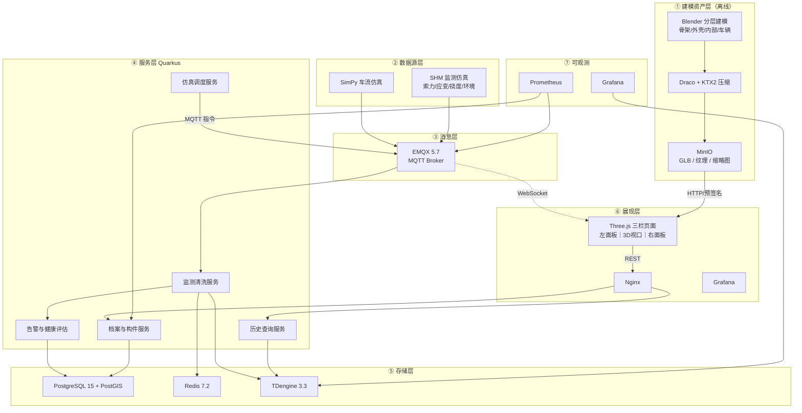

# 智慧桥梁数字孪生系统
# 需求规格 · 架构设计 · 界面还原 · 数据库设计（合订本）

| 项 | 内容 |
|---|---|
| 文档版本 | V1.0 |
| 编制日期 | 2026-11-06 |
| 项目性质 | 个人学习型数字孪生项目（可演示、可讲解、可用于面试作品） |
| 桥型基准 | **双塔双索面斜拉桥**（与三张效果图完全一致） |
| 视觉基准 | 深蓝科技风三栏 HUD，中间 3D 主视口，左右信息面板，底部四幕时间轴 |
| 技术定位 | 全开源免费、Docker Compose 单机、后续可迁飞腾 ARM / 银河麒麟 |
| 文档用途 | 可直接拆成任务卡开发，DDL 可直接执行建库 |

---

## 目录

- [第 0 章 文档说明与阅读路径](#第-0-章-文档说明与阅读路径)
- [第 1 章 项目概述](#第-1-章-项目概述)
- [第 2 章 界面 1:1 还原规范](#第-2-章-界面-11-还原规范)
- [第 3 章 五幕动态序列设计](#第-3-章-五幕动态序列设计)
- [第 4 章 交互联动矩阵](#第-4-章-交互联动矩阵)
- [第 5 章 功能需求清单](#第-5-章-功能需求清单)
- [第 6 章 架构设计](#第-6-章-架构设计)
- [第 7 章 数据库设计](#第-7-章-数据库设计)
- [第 8 章 接口清单](#第-8-章-接口清单)
- [第 9 章 实施路线](#第-9-章-实施路线)
- [第 10 章 验收清单与附录](#第-10-章-验收清单与附录)

---

# 第 0 章 文档说明与阅读路径

## 0.1 三张效果图的作用

本项目的界面不做"自由发挥"，**以三张效果图为唯一视觉基准**，文档中所有尺寸、色值、文案、数值均从图中提取。

| 图序 | 画面主题 | 承担的设计职责 | 本文对应章节 |
|---|---|---|---|
| 图 1 | 双塔斜拉桥全景 + 桥底结构外露 | 定**整体版式**：顶栏标题、左右面板风格 A、底部四幕时间轴、桥体发光材质 | 2.2 / 2.4.1 / 2.6.1 / 2.7 |
| 图 2 | 等轴测视角 + 箱梁剖开 + 蓝图地基 | 定**结构表达**：桥塔/拉索/箱梁/支座/传感器的图形语言，底部图例 | 2.4.2 / 2.6.2 / 2.7 |
| 图 3 | 桥面平视 + 巨型箱梁断口 + 城市夜景 | 定**叙事镜头**：桥梁档案面板、检测预警面板、内部透视热力图与测点表、车流模拟控件 | 2.4.3 / 2.5.3 / 2.6.3 / 2.7 |

## 0.2 阅读建议

- **做前端**：直接看第 2 章（视觉）+ 第 3 章（动画）+ 第 4 章（联动），可以照着量尺寸、取色值。
- **做后端**：看第 6 章（架构）+ 第 7 章（表结构）+ 第 8 章（接口）。
- **做仿真**：看第 3 章车辆部分 + 第 7.6 节 MQTT 报文 + 第 5 章 TRA/SHM 模块。
- **做验收**：看第 10 章清单，逐条勾。

## 0.3 一句话概括产品

> 一个页面，五幕动画：**骨架生长 → 桥面合龙 → 车辆加载 → 结构透视 → 稳态巡检**；左栏讲"这座桥是什么"，右栏讲"这座桥现在怎么样"，中间讲"这座桥长什么样、里面是什么样"。

---

# 第 1 章 项目概述

## 1.1 项目背景

数字孪生园区类项目通常只做"模型 + 数据上色"，缺少**结构本体表达**。桥梁是天然适合做深度孪生的对象：它有明确的层级结构（桩基→承台→桥墩→桥塔→主梁→拉索→桥面系），有明确的力学指标（应力、索力、挠度、振动），也有明确的运营指标（车流、荷载、疲劳）。

本项目以**一座双塔双索面斜拉桥**为对象，做到三件事：

1. **结构可见**：从线框骨架生长到实体成型，从外部到内部（箱梁多室断面、横隔板、加劲肋、支座），用剖切把"看不见的结构"变成主视觉。
2. **运行可见**：桥面车辆按车道样条行驶，车流密度、车速、车辆类型实时变化，车辆荷载联动结构响应指标。
3. **状态可见**：索力、应力、挠度、振动频率、阻尼比、温度、风速等 SHM 指标接入，驱动构件热力着色与告警。

## 1.2 桥梁对象参数（与效果图逐项对齐）

| 参数 | 取值 | 来源 |
|---|---|---|
| 项目编号 | BR-2026 | 图 3 左栏 |
| 桥梁类型 | 斜拉桥（双塔双索面） | 图 3 左栏 |
| 桥塔高度 | 216 m | 图 2 左栏 |
| 主跨 | 480 m | 图 2 左栏 |
| 拉索数量 | 72 根（双索面，每塔每面 18 根） | 图 2 左栏 |
| 箱梁宽度 | 24 m（双向 6 车道 + 中央分隔） | 图 2 左栏 |
| 设计荷载 | 55 t | 图 2 左栏 |
| 建成年份 | 2031 | 图 3 左栏 |
| 设计寿命 | 100 年 | 图 3 左栏 |
| 养护等级 | 一级 | 图 3 左栏 |
| 边跨 | 2 × 180 m | 补充设定（主跨 480 + 两边跨，总长 840 m） |
| 桥面标高 | +58 m（跨江） | 补充设定 |
| 车道 | 上行 3 车道 + 下行 3 车道 | 图 3 桥面 |

> 说明：边跨、桥面标高为效果图未标注项的合理补齐，建模时按此生成；其余全部原样还原。

## 1.3 建设目标（学习目标）

| 编号 | 目标 | 可验证产出 |
|---|---|---|
| G1 | 掌握 Three.js 结构级建模表达 | 桥塔、拉索、箱梁、支座、桩基分层建模，可单独显隐 |
| G2 | 掌握线框生长动画 | 骨架按施工顺序时序生长，可暂停/重播/调速 |
| G3 | 掌握真实剖切 | `ClippingPlane` 沿桥轴推进，露出箱梁多室内部 |
| G4 | 掌握路径动画与实例化 | 36 台车辆沿 CatmullRom 曲线行驶，DrawCall 不随车辆数增长 |
| G5 | 掌握 SHM 数据链路 | 150 测点 → EMQX → 清洗 → Redis/TDengine → 前端热力着色 |
| G6 | 掌握后处理质感 | Bloom + 边缘光 + 星点，达到效果图的"科技发光"观感 |
| G7 | 掌握三栏联动 | 构件树 ↔ 3D 拾取 ↔ 监测面板 三者互驱 |
| G8 | 掌握容器化交付 | `docker compose up -d` 一键起全栈 |

## 1.4 范围边界（明确不做）

| 不做项 | 原因 |
|---|---|
| 有限元（FEM）力学求解 | 学习目标是"可视化 + 数据流"，力学用简化公式映射，不引入 ANSYS/OpenSees |
| 真实 SHM 硬件接入 | 用 Python 仿真脚本，预留 MQTT 主题即可无缝替换 |
| 悬索桥 / 斜拉桥多方案对比 | 锁定单一桥型，保证深度 |
| IFC / BIM 完整解析 | 采用 Blender → GLB 人工拆分建模，可控且轻量 |
| 多桥集群、权限体系、移动端 | 单桥单用户，聚焦主线 |
| 真实视频流接入 | 预留 MediaMTX 扩展点，不实现 |

## 1.5 技术栈（全开源免费）

| 层 | 组件 | 版本 | 用途 | ARM64 |
|---|---|---|---|---|
| 3D | Three.js | r168+ | 场景、动画、剖切、后处理 | — |
| 3D | three/examples（OrbitControls、EffectComposer、UnrealBloomPass、OutlinePass） | 同版本 | 交互与后处理 | — |
| 构建 | Vite + TypeScript | 5.x | 开发服务器与打包 | — |
| 通信 | mqtt.js | 5.x | MQTT over WebSocket | — |
| 建模 | Blender | 4.x | 分层建模、减面、导出 GLB | ✅ |
| 压缩 | glTF-Pipeline（Draco） | 4.x | 几何压缩 | ✅ |
| 压缩 | KTX-Software | 4.x | 纹理转 KTX2 | ✅ |
| 存储 | MinIO | 2025 版 | GLB / 纹理对象存储 | ✅ |
| 网关 | Nginx | 1.24 | 静态缓存 + API 代理 | ✅ |
| 消息 | EMQX | 5.7.x | MQTT Broker（采集/车流/推送） | ✅ |
| 后端 | Quarkus | 3.8.x | 台账、清洗、告警、查询 | ✅ |
| 仿真 | Python 3.11 + SimPy 4.1 | — | 车流 + SHM 仿真 | ✅ |
| 主库 | PostgreSQL 15 + PostGIS 3.3 | — | 档案、构件、测点、告警 | ✅ |
| 缓存 | Redis 7.2 | — | 实时值、车流快照 | ✅ |
| 时序 | TDengine 3.3 | — | 监测历史、回放 | ✅ |
| 监控 | Prometheus + Grafana | — | 指标与看板 | ✅ |
| 编排 | Docker Compose | 24+ | 单机全栈 | ✅ |

> 版本锁定提醒：EMQX 5.8 起为 BSL、Redis 7.4 起为 RSALv2，学习项目锁 5.7 / 7.2。

---

# 第 2 章 界面 1:1 还原规范

> 本章是设计交付的核心。所有数值以 **1680 × 940 设计稿**为基准，实际以 CSS `clamp()` 或 rem 等比缩放；16:9 与 21:9 屏均需适配。

## 2.1 全局视觉令牌

### 2.1.1 色板（从三张图取色）

| 令牌 | 色值 | 用途 |
|---|---|---|
| `--bg-deep` | `#050A18` | 页面最底背景 |
| `--bg-mid` | `#0A162E` | 径向渐变中心色 |
| `--bg-glow` | `#10203F` | 视口中心提亮 |
| `--panel-bg` | `rgba(8, 22, 46, 0.72)` | 左右面板底色 |
| `--panel-border` | `#1B4577` | 面板 1px 描边 |
| `--panel-inner-glow` | `rgba(0, 229, 255, 0.06)` | 面板内发光 |
| `--cyan` | `#00E5FF` | 主强调：发光边、拉索、激活态 |
| `--blue` | `#2C7BE5` | 次级蓝：图标底、进度条 |
| `--blue-light` | `#4DA3FF` | 数值高亮、日期文字 |
| `--text-primary` | `#E8F4FF` | 主数值、标题 |
| `--text-label` | `#8FA9C6` | 标签文字 |
| `--text-dim` | `#A9C1DA` | 次级标签、时间轴文字 |
| `--orange` | `#FF8A1E` | 传感器点、车辆尾灯轨迹 |
| `--orange-light` | `#FFB444` | 光晕、虚线 |
| `--support-yellow` | `#F2C14E` | 支座方块 |
| `--green` | `#2ED47A` | 正常、健康等级 A、完成率 |
| `--warn-yellow` | `#FFC53D` | 预警 |
| `--red` | `#FF4D4F` | 告警、严重 |
| `--purple` | `#7B8CFF` | "预警等级 低"等状态中性色 |
| `--blueprint-line` | `rgba(90, 160, 255, 0.25)` | 地面蓝图线稿、面板背景纹理 |

### 2.1.2 字体

| 用途 | 字族 | 字号 / 字重 | 其他 |
|---|---|---|---|
| 页面主标题「智慧桥梁数字孪生平台」 | 思源黑体 CN Bold | 36px / 700 | 字距 4px，青色外发光 `0 0 24px rgba(0,229,255,.45)` |
| 左栏大标题（如「桥梁档案」） | 思源黑体 CN | 30px / 600 | 前置序号 40px `#E8F4FF` 60% 透明 |
| 面板标题（如「桥梁健康监测」） | 思源黑体 CN | 18px / 600 | 前置 20px 图标 |
| 指标标签 | 思源黑体 CN | 14px / 400 | 色 `--text-label`，字距 1px |
| 指标主数值 | DIN Alternate / Bebas Neue | 36px / 700 | 色 `--text-primary`，字距 1px |
| 数值单位 | DIN Alternate | 20px / 500 | 色 `--text-label`，距数值 6px |
| 表格 / 图例文字 | 思源黑体 CN | 13px / 400 | — |
| 备用显卡字体 | Microsoft YaHei / PingFang SC | — | 数字降级为 Roboto Condensed |

### 2.1.3 间距与形状

| 令牌 | 值 |
|---|---|
| 页面外边距 | 24px |
| 顶栏高度 | 72px |
| 面板圆角 | **4px**（科技风用直角近圆，禁止 12px+ 大圆角） |
| 面板内边距 | 16px 20px |
| 面板标题条高度 | 44px |
| 面板之间间距 | 20px |
| 行高（指标行） | 72px（样式 A）/ 88px（样式 B）/ 56px（样式 C） |
| 分隔线 | 1px `rgba(76,131,196,.22)` |

### 2.1.4 光效与材质

| 效果 | 参数 |
|---|---|
| 面板内发光 | `inset 0 0 40px rgba(0,229,255,.06)` |
| 面板左上角装饰切角 | 8px 斜切（伪元素，`--cyan` 30% 透明描边） |
| 标题下方装饰线 | 1px 渐变 `transparent → #00E5FF 40% → transparent`，长度 100% |
| 数值发光 | `text-shadow: 0 0 12px rgba(0,229,255,.25)` |
| 激活节点 | 双层：内 6px `--cyan`，外 14px `rgba(0,229,255,.35)` |
| 背景网格 | 40px 网格，线色 `rgba(45,110,190,.08)`，仅视口层可见 |

## 2.2 布局网格

```
┌──────────────────────────────────────────────────────────────────────────┐
│  顶栏 72px：左右斜切装饰线 + 居中主标题 + 顶部 1px 青色渐变线            │
├────────────┬──────────────────────────────────────────┬──────────────────┤
│ 左栏 320px │              中间 3D 视口                │   右栏 340px      │
│            │        （flex: 1，最小 720px）           │                  │
│            │                                          │                  │
│  面板 A/B/C│  桥梁主体 + 底图 + 传感器 + 车辆          │  面板 A/B/C       │
│            │                                          │                  │
│            │                                          │                  │
├────────────┴──────────────────────────────────────────┴──────────────────┤
│  底部 HUD 88px：左进度条 ｜ 四幕时间轴 / 车流模拟控件 ｜ 图例 / 右进度条  │
└──────────────────────────────────────────────────────────────────────────┘
```

**尺寸规则**

| 区域 | 1680 基准 | 21:9 适配 | 16:9 适配 |
|---|---|---|---|
| 左栏 | 320px 固定 | 360px | 300px |
| 右栏 | 340px 固定 | 380px | 320px |
| 中间视口 | 920px | ≈ 1240px | ≈ 900px |
| 底部 HUD | 88px | 96px | 80px |
| 左右栏上下堆叠 | 图 1/图 3 为单卡；图 3 左卡 + 左下「结构生长」卡 | 同 | 同 |

**层叠顺序（z-index）**

1. 背景渐变 / 星点（z 0）
2. 3D Canvas（z 1）
3. 视口前景光晕 / 扫描线（z 2，`pointer-events:none`）
4. 左右面板（z 10）
5. 告警弹窗 / 车辆信息卡（z 20）
6. 底部 HUD（z 15）
7. 加载遮罩（z 30）

## 2.3 顶栏规格

| 元素 | 规格 |
|---|---|
| 背景 | 透明，顶部 1px 渐变线 `rgba(0,229,255,.35)` → 透明 |
| 主标题 | 居中，36px / 700，字距 4px，色 `#E8F4FF`，外发光 |
| 左侧装饰 | 从标题左端向左延伸 260px 的斜切线段（2px，两端渐隐），末端 3 个渐隐短横 |
| 右侧装饰 | 镜像 |
| 副信息（可选） | 左上 14px：`BRIDGE-2026 ｜ 在线` + 绿色 6px 呼吸点 |

## 2.4 左侧面板规格（三种样式，按场景选用）

### 2.4.1 样式 A：圆形图标指标卡（对应图 1「桥梁健康监测」）

结构：

```
┌ 卡片 ────────────────────────────────┐
│ [icon] 桥梁健康监测                   │  ← 标题条 44px
├──────────────────────────────────────┤
│  (○)  结构应力                        │
│        42 MPa                        │  ← 行 72px
│  (○)  索力                            │
│        1,280 kN                      │
│  (○)  挠度                            │
│        0.86 m                        │
│  (○)  温度                            │
│        21.4 ℃                        │
│  (○)  风速                            │
│        3.2 m/s                       │
└──────────────────────────────────────┘
```

| 元素 | 规格 |
|---|---|
| 图标圆 | 56px 直径，渐变底 `linear-gradient(135deg,#0A2A5E,#00E5FF 180%)`，2px 描边 `rgba(0,229,255,.55)`，内发光，图标线性白色 24px |
| 图标右侧 | 标签 14px `--text-label`；数值 36px 粗体 + 单位 20px |
| 行间距 | 22px（图标块之间） |
| 数值文案（**必须原样**） | 结构应力 **42 MPa**；索力 **1,280 kN**；挠度 **0.86 m**；温度 **21.4 ℃**；风速 **3.2 m/s** |

### 2.4.2 样式 B：结构信息列表（对应图 2 左栏）

| 元素 | 规格 |
|---|---|
| 顶部 Tab | 高 44px，激活项底 `rgba(44,123,229,.18)`，左侧 3px 青条，文字 18px 粗 |
| 行结构 | 6px 青色圆点 + 标签 16px（上）+ 数值 34px（下），行高 88px |
| 行分隔 | 1px `rgba(76,131,196,.22)`，距左 0 起始 |
| 文案 | 桥塔高度 **216 m**；主跨 **480 m**；拉索数量 **72 根**；箱梁宽度 **24 m**；设计荷载 **55 t** |

### 2.4.3 样式 C：档案行式卡（对应图 3 左栏「1 桥梁档案」）

| 元素 | 规格 |
|---|---|
| 大标题 | 「**1**  桥梁档案」，序号 40px 淡白、标题 30px，下方 40px 宽青色短线 |
| 子卡标题 | 图标 20px + 「桥梁档案」18px，卡片宽 100% |
| 行结构 | 左图标 28px 方形（1px `--blue` 描边，内含线性图标）+ 标签 16px `--text-dim` + 值右对齐 24px `--text-primary`，行高 56px |
| 文案 | 项目编号 **BR-2026**；桥梁类型 **斜拉桥**；建成年份 **2031**；设计寿命 **100 年**；养护等级 **一级** |

### 2.4.4 左下角卡片：结构生长（仅图 3）

| 元素 | 规格 |
|---|---|
| 位置 | 左栏底部，高 220px |
| 标题 | 「结构生长」18px + 40px 青色短线 |
| 内容 | 一个 3D 缩小版点云/网格生长缩略图（彩色渐变点阵，`#00E5FF → #7BFFCF → #FFD166 → #FF6B6B`），可复用主视口的骨架几何体，用小视口 `renderer.setViewport` 渲染 |
| 交互 | 点击缩略图 → 主视口重播骨架生长 |

## 2.5 右侧面板规格

### 2.5.1 样式 A：圆点指标卡（对应图 1「车流与运维」）

| 元素 | 规格 |
|---|---|
| 标题 | 图标 + 「车流与运维」18px |
| 行结构 | 6px 青色圆点 + 标签 14px + 数值 32px，行高 84px |
| 背景纹理 | 面板下层叠加**桥梁断面蓝图线稿**（SVG，`opacity: .12`，`mix-blend-mode: screen`），不遮挡文字 |
| 文案 | 在途车辆 **36 辆**；平均车速 **58 km/h**；车道占用 **62 %**；异常事件 **1 起**；维护建议 **🔧 检查箱梁 B-03**（该行值用 `--green`，字号 20px） |

### 2.5.2 样式 B：实时状态卡（对应图 2 右栏）

| 文案 | 振动频率 **0.48 Hz**；阻尼比 **2.1 %**；车流量 **1,286 辆/小时**；疲劳指数 **38**；健康等级 **A**（绿色 40px，带外发光） |
|---|---|

### 2.5.3 样式 C：检测与预警卡（对应图 3 右栏）

| 元素 | 规格 |
|---|---|
| 行结构 | 左侧 32px 圆形图标（描边 `--blue`，底 `rgba(44,123,229,.12)`）+ 标签 16px + 值右对齐 24px |
| 行高 | 60px，行间 1px 分隔 |
| 文案与配色 | 扫描完成 **94 %**（`--green`）；缺陷数量 **2 处**（`--green`）；重点区域 **箱梁 B-03**（`--text-primary`）；预警等级 **低**（`--purple`）；下次巡检 **2026-11-12**（`--blue-light`） |

### 2.5.4 右下角卡片：内部透视（仅图 3）

| 元素 | 规格 |
|---|---|
| 位置 | 右栏底部，高 260px |
| 标题 | 「内部透视」18px |
| 内容上半 | 热力图色带：竖直渐变条 44×140px，色阶 `#2B1B7A → #4C2BD0 → #D63AA8 → #FF6B3D → #FFD400`，右侧 5 个刻度标签 12px |
| 内容下半 | 测点表格：3 列「测点 / 数值 / 阈值」，行高 26px，文字 12px；测点列前带 4px 状态圆点（绿=正常、黄=预警、红=告警） |
| 表格数据 | C-01 1.290 / 1.350；C-02 1.286 / 1.350；C-03 1.302 / 1.360；C-04 1.278 / 1.350；C-05 1.294 / 1.350；C-06 1.288 / 1.350（单位 MN，即索力） |

## 2.6 底部 HUD 规格

### 2.6.1 四幕时间轴（图 1，主形态）

| 元素 | 规格 |
|---|---|
| 位置 | 底部居中，宽 760px，高 60px |
| 节点 | 4 个，圆点 8px；未激活 `rgba(120,170,220,.55)`；已激活 `--cyan` + 18px 外发光 |
| 连线 | 1px，渐变 `rgba(0,229,255,.6)` → `rgba(255,138,30,.6)` |
| 文案 | 骨架生成 / 桥面合龙 / 车辆加载 / 结构透视，16px，激活态 `--text-primary`，其余 `--text-dim` |
| 交互 | 点击节点 → 立即跳转到该幕结束状态（不重播中间过程） |

### 2.6.2 图例条（图 2）

| 图例 | 图形 | 颜色 |
|---|---|---|
| 拉索 | 24×3 线段 | `#00E5FF` |
| 箱梁 | 20×10 矩形 | `#F2C14E` 描边 + 半透明填充（示意图例中箱梁为黄/灰块） |
| 支座 | 12×12 方块 | `#F2C14E` |
| 传感器 | 6px 圆点 | `#FF8A1E` |
| 车辆轨迹 | 24px 虚线（2 段） | `#FF8A1E` |

> 图例居中排列，间距 40px，文字 14px `--text-dim`。说明：效果图中箱梁/支座用黄灰色块示意，实现时以图例为准。

### 2.6.3 车流模拟控件（图 3）

| 元素 | 规格 |
|---|---|
| 位置 | 底部居中，宽 640px |
| 播放按钮 | 28px 圆形，金色 `#F2C14E` 填充，内含三角/暂停图标 |
| 标签 | 「车流模拟」16px `--text-primary`，距按钮 12px |
| 滑块 | 高 4px；已填充段渐变 `#F2C14E → #00E5FF`；滑块头 14px 圆点 |
| 数值 | 右侧 14px 显示当前车流密度百分比（如 `62%`） |
| 底部进度条 | 左右各一条，宽 260px：底槽 `rgba(30,70,130,.6)`，进度 `#2C7BE5`，两端 `+ / -` 24px 圆形按钮 |

## 2.7 中间 3D 视口视觉规格

### 2.7.1 环境

| 元素 | 规格 |
|---|---|
| 背景 | 径向渐变 `#050A18 → #0A162E`，中心偏移到桥体位置 |
| 星点 | 800 个 Points，尺寸 0.6~1.4px，透明度 0.25~0.6，缓慢闪烁 |
| 远景 | 城市天际线剪影（图 3）：低多边形楼群，色 `#0E1B33`，距相机 1200 单位，`fog` 融合 |
| 水面 | 平面 2000×2000，`MeshStandardMaterial` color `#061224`，roughness 0.15，metalness 0.6，反射桥体倒影（可用 `Reflector`，性能不足时降级为纯色） |
| 地面蓝图 | 桥下延伸的线框结构（图 2 左下）：`LineSegments`，色 `rgba(90,160,255,.22)`，模拟"未建成的既有结构" |
| 雾 | `FogExp2` color `#061020` density 0.0022 |

### 2.7.2 相机

| 项目 | 值 |
|---|---|
| 类型 | PerspectiveCamera，fov 40，near 0.5，far 4000 |
| 初始位（图 1） | 侧前方 3/4 视角，azimuth ≈ 35°，elevation ≈ 18°，目标点跨中 |
| 图 2 位 | 等轴测 az 45° / el 28°，距离更远（全景 + 地基线框入画） |
| 图 3 位 | 桥面平视，相机贴桥面高 +4m，沿桥轴向前，目标点远处桥塔 |
| 剖切位 | 桥底仰视，elevation ≈ -22°，看向箱梁断口 |
| 控制器 | OrbitControls（damping 0.08，maxPolarAngle 1.45，minDistance 40，maxDistance 1200） |

### 2.7.3 结构件材质

| 构件 | 主色 | 特殊处理 |
|---|---|---|
| 桥塔（216m 门型） | 混凝土 `#B9C4D2`，粗糙度 0.85 | 边缘 Fresnel 青色描边（自定义 Shader，强度 0.35）；塔身横向分层线（每 12m 一条细线） |
| 拉索（72 根扇形双索面） | 管状 `TubeGeometry` 半径 0.06 | `emissive #00E5FF`，强度 1.2；沿索流动光点（每 0.3s 前移一次） |
| 主梁（箱梁，宽 24m） | 外侧 `#8E9AAB`；顶面沥青 `#2A3038` | 车道线：白虚线 + 黄实线（贴图或几何贴花）；梁侧青色发光带（emissive 随车速脉冲） |
| 箱梁内部（剖切后可见） | 内壁 `#C8D3E0`，腹板 `#AEBACB`，横隔板 `#9BA8BA` | 内壁加环境遮蔽（AO 贴图）增强体积感；剖切轮廓线用 `#00E5FF` 2px 描边 |
| 桥墩 / 承台 | `#8B97A6` | 承台略深 `#77828F` |
| 桩基 | `#6E7A88` | 只在水面以下、剖切时可见 |
| 支座 | **`#F2C14E`**（明确黄色块，图 2/图 3 特征） | 高 1.2m，方 2.4×1.6m，金属 roughness 0.4 |
| 护栏 | 金属 `#6A7686` | 竖向立柱每 2m 一根，横向双道 |
| 路面标线 | 白 `#FFFFFF` 60% 透明，黄 `#F2C14E` | — |

### 2.7.4 传感器与数据可视化

| 类型 | 表现 |
|---|---|
| 传感器点位 | 橙色 `#FF8A1E` 小球（0.35m）+ 24px 光晕 + 垂直向下虚线（`#FF8A1E` 40% 透明，长 4m）—— 图 2/图 3 中箱梁下方的橙色竖线即此 |
| 正常态 | 橙色常亮，缓慢呼吸（透明度 0.6~1.0，周期 2.4s） |
| 预警态 | 转黄 `#FFC53D`，闪烁周期 1.2s |
| 告警态 | 转红 `#FF4D4F`，快速脉冲 0.5s + 外扩波纹环 |
| 构件热力着色 | 按测点值映射 `#2C7BE5`（正常）→ `#FFC53D`（预警）→ `#FF4D4F`（告警），映射到构件 `emissive` 通道，保留原材质 |
| 等值面（可选 P2） | 箱梁表面热力贴图（CanvasTexture 动态绘制） |

### 2.7.5 车辆

| 项目 | 规格 |
|---|---|
| 车型 | 小车（4.6×1.9×1.5m）与货车（9.5×2.5×3.4m）两款低模 |
| 数量 | 稳态 36 台（图 1「在途车辆 36 辆」） |
| 渲染 | 每车型一个 `InstancedMesh`，实例矩阵每帧更新；总 DrawCall ≤ 4 |
| 灯光 | 尾灯 `#FF3B30` 自发光，前灯 `#FFFFFF` 自发光，仅夜间/暗场开启 |
| 拖尾 | 高速（> 80km/h）时在车后 8m 生成半透明长条（`opacity 0.18`，`#FF8A1E`），图 1 桥面橙色流光即此效果 |
| 运动 | 沿 `CatmullRomCurve3` 车道曲线匀速运动，`curve.getPointAt(t)` 更新位置与朝向；t 按车速归一化推进 |
| 车道 | 上行 3 车道 + 下行 3 车道，每车道独立曲线，车道中心横向偏移 ±1.75m、±5.25m、±8.75m |

### 2.7.6 后处理链

```
RenderPass
  → UnrealBloomPass(strength 0.62, radius 0.42, threshold 0.85)
  → 可选 SSAOPass（低端设备关闭）
  → OutputPass（色彩空间校正，ACESFilmic）
```

抗锯齿：`antialias: true`，`pixelRatio = min(devicePixelRatio, 2)`。

### 2.7.7 剖切

| 项目 | 规格 |
|---|---|
| 实现 | `THREE.Plane(normal, constant)` + `renderer.clippingPlanes` |
| 作用对象 | 仅箱梁外壳（`girderShell` 层），不影响塔、索、车、地面 |
| 法向 | 默认沿桥轴 `(−1, 0, 0)`，可从侧向 `(0, 0, −1)` 剖开看断面 |
| 动画 | `constant` 从 +∞ 线性推到目标值，2.2s easeInOutCubic；剖切边缘用 `#00E5FF` 描边（复制一份几何体，`clipIntersection` 关闭，用 `LineBasicMaterial` 描边） |
| 内部补面 | 剖切后需露出**断面封口**（否则看到空壳），在 Blender 中为箱梁预生成断面补齐面，或用 `Material.side = DoubleSide` + 内壁单独建模 |
| 内部件显隐 | 钢筋/预应力束/横隔板/加劲肋 分组显隐，与剖切进度联动 |

---

# 第 3 章 五幕动态序列设计

> 这是项目的"灵魂"。整段序列 **12.5 秒**，之后进入稳态巡检循环。用户可随时点击底部节点跳转，也可重播。

## 3.1 总时间轴

```
0s ──────── 4.5s ──────── 7.5s ──────── 9.5s ──────── 12.5s ──────▶ 循环
  幕一        幕二          幕三           幕四            幕五
 骨架生成    桥面合龙      车辆加载       结构透视        稳态巡检
```

## 3.2 幕一：骨架生成（0 → 4.5s）

| 项目 | 内容 |
|---|---|
| 视觉目标 | 从"没有桥"到"桥的线框骨架完整"，体现施工建造逻辑 |
| 生长顺序 | 桩基（0~0.6s）→ 承台（0.6~1.2s）→ 桥墩（1.2~1.8s）→ 桥塔（1.8~3.2s，自下而上 216m）→ 主梁骨架（3.2~4.0s，从两塔向两侧对称延伸）→ 拉索（4.0~4.5s，扇形依次"拉出"） |
| 材质 | `MeshBasicMaterial` + `wireframe: true`，色 `#00E5FF`，透明度 0.9；叠加一层 20px 描边线（`LineSegments`） |
| 生长实现 | 每个构件用 `scale.y` 从 0→1（`setScalar` 只改 y）+ 顶点裁剪：`geometry.setDrawRange(0, count * progress)`，让线框"逐段画出来"而非整体拉伸 |
| 扫描光 | 一条水平青色光带（Plane 高 0.6m，`#00E5FF`，additive）跟随生长高度上移 |
| 粒子 | 生长点周围 60 个粒子（`#00E5FF`）向外扩散后消失，营造"能量凝聚"感 |
| 相机 | 从桥侧远景 `(600, 120, 600)` 缓推到 `(420, 180, 520)`，视为目标跨中 |
| HUD | 时间轴节点 1 点亮；左栏数值从 0 滚动到目标值（结构应力 0→42MPa） |
| 音效（可选） | 低频嗡鸣 + 电流声 |

## 3.3 幕二：桥面合龙（4.5 → 7.5s）

| 项目 | 内容 |
|---|---|
| 视觉目标 | 骨架"蒙皮"成实体，桥面从两端向跨中合龙，闪光一瞬间 |
| 步骤 | ① 4.5~5.2s：线框渐变为实体（材质插值：wireframe opacity 1→0，实体 opacity 0→1）<br>② 5.2~6.6s：箱梁节段（共 42 个节段，每 20m 一节）从两侧向跨中逐个"推入"，带 1.5s 的位移缓动<br>③ 6.6~7.0s：跨中合龙，一道白光竖闪（`#FFFFFF`，宽度 2m，持续 0.4s）+ Bloom 强度瞬间拉到 1.4<br>④ 7.0~7.5s：拉索张拉，索体从松弛的曲线拉到设计线形（用 `Line` 顶点插值）；桥面标高微微起拱 2cm 的视觉暗示 |
| 材质 | 混凝土 `#B9C4D2`，沥青顶面 `#2A3038`；拉索 `#00E5FF` emissive 亮起 |
| 相机 | 缓慢下降并横移，越过桥塔，视线沿桥轴向前 |
| HUD | 节点 2 点亮；左栏「桥塔高度 216m」逐位计数到 216 |

## 3.4 幕三：车辆加载（7.5 → 9.5s）

| 项目 | 内容 |
|---|---|
| 视觉目标 | 空桥 → 车流涌现，桥"活"了 |
| 步骤 | ① 7.5s 桥面车道线亮起（白线自上而下扫描一次，0.5s）<br>② 7.5~9.0s：车辆从两端入口依次驶入，数量 0→36，密度按 easeOutQuad 爬升<br>③ 8.5~9.5s：桥侧发光带亮度随车速脉冲（`emissiveIntensity` 由 0.2 升到 0.9） |
| 车辆行为 | 首批 8 台于 7.5s 同时出现在两端（错开车道），后续每 80ms 生成一台；车速 40~80km/h 随机，货车占 15% |
| 相机 | 相机贴近桥面（+4m），沿桥轴向前缓慢推进（图 3 视角），可见车流迎面/背向 |
| HUD | 节点 3 点亮；右栏「在途车辆」从 0 滚动到 36，平均车速 58km/h，车道占用 62% |

## 3.5 幕四：结构透视（9.5 → 12.5s）

| 项目 | 内容 |
|---|---|
| 视觉目标 | 相机下潜到桥底，箱梁外壳被剖开，露出多室箱梁内部（顶板/底板/腹板/横隔板/加劲肋/预应力束） |
| 步骤 | ① 9.5~10.8s：相机沿贝塞尔曲线从桥面下潜到桥底仰视位（路径经过桥墩外侧，不穿模）<br>② 10.2~11.6s：剖切平面从跨中向两侧推进，外壳渐隐，剖切边缘青色高亮<br>③ 11.0~12.0s：内部结构化显：横隔板先亮，再亮腹板加劲肋，最后预应力束（青色细管）<br>④ 11.6~12.5s：传感器全部点亮，橙点 + 橙色垂直虚线出现（图 2 特征） |
| 材质 | 内部混凝土 `#C8D3E0`，AO 增强；剖切面封口 `#DCE6F2`；预应力束 `#00E5FF` 高亮 |
| 相机 | 目标点固定在箱梁断口中心，仰角 −22°，距离 90 |
| HUD | 节点 4 点亮；右栏切换为「内部透视」卡（热力图 + 测点表） |

## 3.6 幕五：稳态巡检（12.5s 后循环）

| 项目 | 内容 |
|---|---|
| 相机 | 以断口为中心缓慢环绕（±12°，周期 24s），轻微呼吸推拉 |
| 车流 | 持续运行，车辆数在 30~40 之间浮动（模拟自然波动） |
| 数据 | 每 2s 刷新索力、应变、挠度；热力图与测点表同步 |
| 告警 | 触发时对应传感器与构件红色脉冲，右栏告警行插入顶部 |
| 交互 | 用户任何操作（拖拽、点击、滑块）立即接管相机，暂停自动运镜 8s 后恢复 |

## 3.7 动画技术实现要点

| 动画 | 实现 | 注意 |
|---|---|---|
| 线框生长 | `setDrawRange` + `scale.y` | 需按构件拆分几何体，不能整桥一个 mesh |
| 材质过渡 | `material.opacity` 插值 + `transparent:true` | 透明排序问题：实体先渲染，线框设 `depthWrite:false` |
| 节段推入 | 每个节段独立 Group，位置从 ±offset 缓动到 0 | 42 个节段用 `Object3D` 数组管理 |
| 相机运镜 | 自写 `CameraAnimator`（贝塞尔曲线 + 时间轴），不用 Tween 库亦可 | 关键帧表存 JSON，便于调 |
| 剖切 | `renderer.clippingPlanes = [plane]` + `localClippingEnabled = true` | 注意 `material.clippingPlanes` 需逐材质设置 |
| 车辆 | `InstancedMesh.setMatrixAt` | 每帧 `instanceMatrix.needsUpdate = true` |
| 统一时序 | 一个 `Timeline` 管理器，`elapsed` 驱动所有 `progress`，暂停/倍速只改 `timeScale` | 避免各自 `setTimeout` 不同步 |

## 3.8 降级策略（低端设备）

| 条件 | 降级 |
|---|---|
| `devicePixelRatio` > 2 且 帧率 < 25 | 像素比降为 1.5，关闭 Bloom |
| 帧率 < 20 持续 3s | 关闭星点、水面反射、SSAO；车辆上限降为 18 |
| WebGL2 不可用 | 显示提示页，不做 3D |

---

# 第 4 章 交互联动矩阵

| 触发源 | 动作 | 左栏响应 | 右栏响应 | 3D 视口响应 |
|---|---|---|---|---|
| 左栏构件树点击「1# 桥塔」 | 选中构件 | 展开该构件档案 | 过滤为该塔下测点（索力 18 个、位移 3 个） | 相机飞行到该塔（1.2s），构件高亮描边 |
| 3D 点击构件 | 射线拾取 | 加载构件档案卡 | 过滤测点 | 高亮选中 + OutlinePass |
| 右栏点击某测点 | 查看趋势 | — | 展开该测点 24h 折线（迷你图） | 对应传感器点放大 1.5 倍并闪光 |
| 底部时间轴点击节点 | 跳幕 | 数值切换到该幕终态 | 面板按幕切换（幕四切「内部透视」） | 直接跳到该幕末帧 |
| 「剖切」开关 | 剖切 | — | 显示剖切进度条 | ClippingPlane 推进 2.2s |
| 车流滑块拖动 | 改密度 | 在途车辆数实时变化 | 滑块百分比同步 | 车辆生成/回收速率变化 |
| 车辆点击 | 查看车辆 | — | 弹出车辆卡（车型/重量/车速/车道） | 车辆高亮 |
| 告警推送 | 告警 | 构件树对应项标红点 | 告警行插入顶部，红色 | 传感器红闪 + 构件脉冲 |
| 右栏「回放」 | 历史回放 | 时间显示切换到历史 | 曲线按历史数据绘制 | 车辆按历史轨迹重现，构件颜色按历史值 |
| 左栏「结构生长」缩略图点击 | 重播 | — | — | 从幕一重播 |

**联动数据契约**：所有面板共享一个 `selectedContext`（`{bridgeCode, compCode, pointCodes[], act, timeCursor}`），由状态机（Pinia/Zustand 或简单 EventBus）统一管理，禁止各面板互相直接调用。

---

# 第 5 章 功能需求清单

> 优先级：P1 必做 / P2 应做 / P3 可选。每条含验收标准，可直接转测试用例。

## 5.1 模块一：桥梁档案与构件（BRG）

| ID | 名称 | 优先级 | 详细描述 | 验收标准 |
|---|---|---|---|---|
| BRG-001 | 桥梁档案维护 | P1 | 维护桥梁编码、名称、类型（斜拉桥）、项目编号、桥塔高度、主跨、边跨、总长、桥面宽度、拉索数量、设计荷载、建成年份、设计寿命、养护等级、所在地、管理单位。支持增删改查与分页。 | 新增后列表可见；项目编号 BR-2026 与效果图一致 |
| BRG-002 | 构件层级管理 | P1 | 构件类型：桩基、承台、桥墩、桥塔、主梁节段、横隔板、拉索、支座、伸缩缝、护栏、桥面铺装。每个构件唯一编码、所属桥梁、父构件（支持树形，如 塔→节段）。 | 构件树可展开三级：桥梁 → 塔/梁 → 节段；删除父构件时校验子构件 |
| BRG-003 | 构件模型绑定 | P1 | 每个构件绑定三套模型：骨架线框 `model_skeleton_code`、实体外壳 `model_solid_code`、内部结构 `model_inner_code`；记录位移/旋转/缩放。 | 三套模型均可单独加载；缺内部模型时剖切只显示空腔 |
| BRG-004 | 拉索专项管理 | P1 | 拉索编码（C-01 ~ C-72）、所属塔、索面（左/右）、索号、锚固点坐标、设计索力、当前索力、张拉日期。 | 72 根拉索数据完整；可按塔/索面筛选 |
| BRG-005 | 箱梁节段管理 | P1 | 节段编码（如 B-03）、里程桩号、节段长度（20m）、断面形式（单箱多室）、室数（4）、板厚参数、重量。 | 42 个节段按里程排序；点击节段可在 3D 定位 |
| BRG-006 | 车道路径配置 | P1 | 车道编码、方向（上行/下行）、车道序号、样条控制点数组（JSON）、限速；共 6 条车道。 | 前端按配置生成 6 条曲线，车辆不越道 |
| BRG-007 | 视点预设 | P1 | 保存俯视全景、桥面平视、桥底剖切、塔柱特写 4 个视点（相机位置 + 目标 + fov）。 | 一键切换平滑过渡 1.2s |
| BRG-008 | 剖切方案配置 | P1 | 方案编码、名称、剖切法向(x,y,z)、剖切距离、是否显示钢筋/隔板/加劲肋。 | 切换方案后剖切位置与显隐同步变化 |
| BRG-009 | 动画分幕配置 | P2 | 保存五幕动画的时间轴：每幕起止时间、相机关键帧、构件分组、是否自动播放。 | 修改时长后动画按新时长播放 |
| BRG-010 | 模型资源管理 | P1 | 复用资源表：GLB 上传至 MinIO，记录编码、大小、MD5、Draco 标记、LOD 级别、缩略图；被引用时禁止删除。 | 上传 30MB GLB 成功并返回可访问 URL |

## 5.2 模块二：动态可视化（VIS）

| ID | 名称 | 优先级 | 详细描述 | 验收标准 |
|---|---|---|---|---|
| VIS-001 | 骨架生长动画 | P1 | 页面初始化自动播放；顺序为 桩基→承台→桥墩→桥塔→主梁→拉索；使用线框材质逐段绘制；支持重播、暂停、0.5x~2x 倍速。 | 动画总时长 4.5s±0.3s；顺序正确；重播无残留 |
| VIS-002 | 桥面合龙动画 | P1 | 线框转实体；箱梁节段从两侧向跨中推进；跨中白闪 0.4s；拉索张拉到位。 | 合龙瞬间有明显视觉高光；节段无穿模 |
| VIS-003 | 车辆加载动画 | P1 | 车道线扫描亮起；车辆 0→36 台渐入；桥侧发光带脉冲。 | 车辆数 36 台；无重叠；帧率 ≥ 25fps |
| VIS-004 | 桥底结构透视 | P1 | 相机下潜至桥底仰视；剖切箱梁外壳；显示顶板/底板/腹板/横隔板/加劲肋/预应力束；传感器点亮。 | 内部件全部可见；剖切边缘有青色描边；不穿透桥塔 |
| VIS-005 | 线框/实体切换 | P1 | 任意构件可单独切换线框或实体；支持整桥一键切换。 | 切换即时生效，无材质错乱 |
| VIS-006 | 剖切参数调节 | P1 | 滑块控制剖切平面位置；可切换剖切方向（沿桥轴 / 垂直桥轴）。 | 滑块拖动实时更新，无明显卡顿 |
| VIS-007 | 构件显隐控制 | P1 | 构件树复选框控制显隐；支持「只看内部结构」快捷模式（隐藏外壳 + 铺装 + 护栏）。 | 勾选后 3D 立即隐藏，不影响其他构件 |
| VIS-008 | 应力热力着色 | P1 | 测点值映射构件 `emissive` 颜色：正常蓝 → 预警黄 → 告警红；随数据 2s 刷新。 | 造超限数据后构件 2s 内变红 |
| VIS-009 | 构件拾取 | P1 | 射线拾取所有实体构件与传感器点，返回 compCode；高亮描边。 | 连点 10 个构件均准确命中，无错位 |
| VIS-010 | 传感器光效 | P1 | 橙球 + 光晕 + 垂直虚线；三态（正常/预警/告警）颜色与闪烁频率不同。 | 三态肉眼可区分 |
| VIS-011 | 相机运镜系统 | P1 | 五幕相机关键帧插值；用户操作时暂停自动运镜，8s 后恢复。 | 过渡平滑无跳变；操作后不抢夺控制权 |
| VIS-012 | 后处理链 | P2 | Bloom + ACES 色调映射；低端设备自动关闭。 | 夜间桥体有明显青蓝辉光，不糊 |
| VIS-013 | 结构生长缩略图 | P2 | 左栏小视口复用主场景渲染骨架，彩色点云渐变。 | 缩略图与主视口同步 |

## 5.3 模块三：车流仿真（TRA）

| ID | 名称 | 优先级 | 描述 | 验收标准 |
|---|---|---|---|---|
| TRA-001 | SimPy 车流生成 | P1 | 按车道独立生成车辆，泊松到达；车型按 85% 小车 / 15% 货车；车速 40~80km/h 正态分布；支持密度参数 0~100%。 | 密度 62% 时稳定 30~40 台在途 |
| TRA-002 | 车辆路径动画 | P1 | 前端按 MQTT 报文驱动车辆沿 `CatmullRomCurve3` 运动；`getPointAt(t)` + 切线朝向。 | 车辆不脱离车道、朝向正确、无抖动 |
| TRA-003 | 车流控制 | P1 | 启停、密度滑块、车速调节、车辆显隐。 | 滑块拖动后 1s 内在途数变化 |
| TRA-004 | 车辆荷载联动 | P2 | 货车经过某节段时，该节段应变/挠度指标短时抬升（简化系数模型）。 | 货车过境时对应测点曲线有可见凸起 |
| TRA-005 | 车辆信息卡 | P2 | 点击车辆弹出卡片：车牌（虚拟）、车型、载重、车速、车道、驶入时间。 | 点击命中率 100% |
| TRA-006 | 车道占用统计 | P1 | 统计各车道车辆数与占用率，推送到右栏。 | 6 车道占用率之和与总车辆数匹配 |
| TRA-007 | 轨迹可视化 | P2 | 车辆后方绘制 2s 淡出轨迹线（橙色虚线，对应图 2 图例）。 | 轨迹随车移动，2s 后消失 |

## 5.4 模块四：SHM 监测（SHM）

| ID | 名称 | 优先级 | 描述 | 验收标准 |
|---|---|---|---|---|
| SHM-001 | 测点类型字典 | P1 | 预置：结构应力(MPa)、索力(kN)、挠度(m)、振动频率(Hz)、阻尼比(%)、温度(℃)、风速(m/s)、支座位移(mm)、裂缝宽度(mm)。 | 9 类齐全，单位正确 |
| SHM-002 | 测点定义 | P1 | 测点绑定构件；含编码、名称、类型、单位、预警上下限、告警上下限、采集周期、坐标。共 150 个。 | 72 个索力点 + 42 个应变点 + 其余环境点 |
| SHM-003 | 原始报文消费 | P1 | 订阅 `sensor/raw/bridge/+`，QoS1，4 线程消费；校验 bridgeCode/pointCode/value 合法性与时间偏差。 | 300 条/秒无积压；脏数据被丢弃并计数 |
| SHM-004 | 实时缓存 | P1 | 写入 `realtime:shm:{pointCode}`，含 value/unit/ts/level。 | 上报后 1s 内可读 |
| SHM-005 | 时序入库 | P1 | 批量写 TDengine（100 条或 200ms）。 | 行数与上报数一致 |
| SHM-006 | 清洗后推送 | P1 | 发布 `realtime/bridge/{bridgeCode}`，含该桥全部测点最新值与聚合指标。 | 前端一次收到整桥快照 |
| SHM-007 | 指标聚合 | P1 | 计算并推送：结构应力(取最大)、索力(取最大)、挠度(跨中)、温度(均值)、风速、振动频率、阻尼比、疲劳指数、健康等级 A~E。 | 数值与效果图口径一致 |
| SHM-008 | 测点分组 | P1 | 按「塔 / 主梁 / 支座 / 环境」四组展示。 | 分组切换后列表正确 |
| SHM-009 | 仿真数据源 | P1 | Python 脚本按物理规律生成数据：索力随温度与车流变化、应变随荷载波动、挠度与车流正相关。 | 曲线自然，无锯齿随机噪声 |

## 5.5 模块五：告警与健康（ALM）

| ID | 名称 | 优先级 | 描述 | 验收标准 |
|---|---|---|---|---|
| ALM-001 | 阈值告警 | P1 | 超预警限 → 黄色预警；超告警限 → 红色告警；连续 3 次才触发（防抖）。 | 连续 2 次不告警，第 3 次告警 |
| ALM-002 | 告警推送 | P1 | 发布 `alarm/bridge/event`，含 alarmCode、等级、测点、值、阈值、文案、定位坐标。 | 前端 1s 内弹窗 + 定位 |
| ALM-003 | 告警确认 | P1 | 前端可确认/忽略，状态 ACTIVE→CONFIRMED/IGNORED。 | 状态落库并可查 |
| ALM-004 | 自动恢复 | P1 | 数值回落连续 3 次正常，置 RECOVERED 并推送 `alarm/bridge/recover`。 | 恢复后告警行变灰并标注恢复时间 |
| ALM-005 | 健康评分 | P2 | 公式：`100 - 告警扣分 - 偏离扣分`，映射 A(≥90)/B(80~89)/C(70~79)/D(60~69)/E(<60)。 | 健康等级与效果图 A 级一致（初始态） |
| ALM-006 | 疲劳指数 | P2 | 按累计车流与荷载幅值估算 0~100，效果图基准值 38。 | 车流密度提高时指数上升 |
| ALM-007 | 缺陷台账 | P2 | 记录的缺陷（2 处）、位置（箱梁 B-03）、等级（低）、下次巡检日期（2026-11-12）。 | 与右栏「检测与预警」一致 |

## 5.6 模块六：前端页面（WEB）

| ID | 名称 | 优先级 | 描述 | 验收标准 |
|---|---|---|---|---|
| WEB-001 | 三栏布局 | P1 | 顶栏 + 左 320 / 中 flex / 右 340 + 底部 HUD；1680 基准，等比缩放。 | 1920×1080、2560×1080 均不变形 |
| WEB-002 | 面板组件化 | P1 | 三种面板样式（圆形图标卡 / 列表卡 / 档案行卡）做成可配置组件，数据驱动。 | 换数据不改结构 |
| WEB-003 | 数值滚动 | P1 | 数值变化时 0.6s 数字滚动（不是瞬间跳变）。 | 观感平滑，与动画幕同步 |
| WEB-004 | 首屏加载 | P1 | 显示加载进度（模型解析 / 纹理 / 动画准备），完成后自动播放五幕。 | 首屏 ≤ 8s |
| WEB-005 | 相机控制 | P1 | 轨道 + 第一人称 WASD；视角切换按钮。 | 两种模式切换正常 |
| WEB-006 | 响应式降级 | P2 | < 1440px 时左右栏收窄为 280/300；< 1200px 时折叠为抽屉。 | 小屏可用不遮挡桥体 |
| WEB-007 | 图例与时间轴 | P1 | 底部图例（5 项）+ 四幕时间轴可点击。 | 与效果图文案一致 |
| WEB-008 | 全屏与截图 | P3 | 支持全屏展示、一键截图（`renderer.domElement.toDataURL`）。 | 截图含 UI 层 |

## 5.7 模块七：回放与统计（RPT）

| ID | 名称 | 优先级 | 描述 | 验收标准 |
|---|---|---|---|---|
| RPT-001 | 时序查询 | P1 | 按测点/时间/降采样间隔查询 TDengine，返回统一时间轴多序列。 | 6 测点 24h、10s 降采样 ≤ 1s |
| RPT-002 | 历史回放 | P1 | 时间轴拖动，3D 状态、构件颜色、车辆轨迹按历史复现。 | 拖动流畅，无数据空洞 |
| RPT-003 | 区间统计 | P1 | 最大/最小/均值/P95/超限次数。 | 与原始数据核对一致 |
| RPT-004 | Grafana 看板 | P2 | 索力/应变/挠度趋势、告警统计、车流统计。 | 看板自动刷新 |

## 5.8 模块八：系统（SYS）

| ID | 名称 | 优先级 | 描述 |
|---|---|---|---|
| SYS-001 | 登录 | P2 | 单账号 + JWT（8h），除登录外全部鉴权 |
| SYS-002 | 系统配置 | P2 | MQTT/TDengine/MinIO 地址、防抖次数、缓存 TTL 可在线改 |
| SYS-003 | 操作日志 | P3 | 记录剖切方案变更、动画重播、回放、告警确认 |
| SYS-004 | 健康检查 | P1 | `/q/health` 聚合 PG/Redis/TDengine/MinIO 连通性 |

---

# 第 6 章 架构设计

## 6.1 设计原则

| 原则 | 落地 |
|---|---|
| **结构分层，不整桥一 mesh** | 桥梁按 桩基/承台/墩/塔/节段/拉索/支座/铺装/内部件 拆成独立 Group，动画与显隐才可能 |
| **动画与数据解耦** | 动画由本地 Timeline 驱动，MQTT 数据只改材质与数值，不参与时序 |
| **剖切只切外壳** | `clippingPlanes` 只作用于 `girderShell` 层，避免误切塔、车、地面 |
| **实时与历史分离** | 最新值 Redis，历史 TDengine |
| **仿真同构** | 仿真报文与真实传感器格式一致，`source` 字段区分来源 |
| **渲染压力在前端，计算在后端** | 车辆位置由前端插值算，后端只发稀疏状态；避免高频报文 |
| **组件可降级** | 后处理、星点、水面反射均可一键关闭 |

## 6.2 分层架构



## 6.3 渲染架构（前端内部）

```
App
├── Layout（三栏 + 顶栏 + HUD）
├── Store（selectedContext / metrics / act / alerts）
├── ThreeLayer
│   ├── SceneManager        场景、相机、渲染器、后处理
│   ├── AssetLoader         GLB 加载（骨架/外壳/内部/车辆），Draco 解码
│   ├── ComponentRegistry   构件 Group 注册表（compCode → Object3D）
│   ├── Timeline            五幕统一时序驱动器（elapsed/timeScale）
│   │   ├── ActSkeleton     幕一 骨架生长
│   │   ├── ActClosure      幕二 合龙蒙皮
│   │   ├── ActTraffic      幕三 车辆加载
│   │   └── ActCutaway      幕四 剖切透视
│   ├── CameraDirector      关键帧插值 + 用户接管
│   ├── TrafficEngine       InstancedMesh + CatmullRom 路径
│   ├── SensorLayer         传感器点 + 光晕 + 虚线
│   ├── ClippingController  Plane + 剖切描边
│   ├── HeatMapper          测点值 → 材质 emissive
│   ├── Picker              Raycaster
│   └── PostProcess         Bloom / ACES
└── Panels
    ├── LeftPanel（档案 / 结构信息 / 健康指标 / 结构生长缩略图）
    ├── RightPanel（车流运维 / 实时状态 / 检测预警 / 内部透视）
    └── BottomHud（四幕时间轴 / 图例 / 车流模拟）
```

## 6.4 数据流（三条链路）

**链路 A：监测数据**

```
SimPy → sensor/raw/bridge/{bridgeCode} → Quarkus 清洗
   ├→ Redis  realtime:shm:{pointCode}
   ├→ TDengine shm_metric
   ├→ 阈值判定 → alm_alarm（PG）+ alarm/bridge/event
   └→ realtime/bridge/{bridgeCode}
                    ↓ WebSocket
                前端 HeatMapper / SensorLayer / 右栏面板
```

**链路 B：车流数据**

```
SimPy（每 1s 推一次稀疏状态：总车辆数、平均车速、车道占用、新增/回收车辆）
   → traffic/vehicle/{bridgeCode}
   → 前端 TrafficEngine（本地插值补帧，逐帧 getPointAt）
```

**链路 C：时序回放**

```
前端时间轴 → GET /history/series?points=&start=&end=&interval=
   → TDengine INTERVAL 降采样 → 前端逐帧回放（车辆按历史轨迹重现）
```

## 6.5 部署拓扑

| 服务 | 镜像 | 端口 | 内存上限 | 说明 |
|---|---|---|---|---|
| postgres | postgis/postgis:15-3.3 | 5432（仅内网） | 1G | 业务库 |
| redis | redis:7.2-alpine | 6379 | 256M | 实时缓存 |
| tdengine | tdengine/tdengine:3.3 | 6030/6041 | 1G | 时序库 |
| minio | minio/minio:2025 | 9000/9001 | 512M | 模型存储 |
| emqx | emqx/emqx:5.7 | 1883/8083/18083 | 512M | MQTT |
| nginx | nginx:1.24 | 80 | 128M | 前端 + API |
| svc-bridge | 本地构建 | 8081 | 512M | 档案/构件/查询 |
| svc-shm | 本地构建 | 8082 | 512M | 清洗/告警 |
| simulator | 本地构建（Python） | — | 512M | 车流 + SHM 仿真 |
| prometheus | prom/prometheus | 9090 | 256M | 指标 |
| grafana | grafana/grafana | 3000 | 256M | 看板 |

单机建议：4C / 8G / 40G SSD；最低 4C / 4G（关 Grafana）。

## 6.6 工程目录

```
bridge-digital-twin/
├── docker-compose.yml
├── .env.example
├── deploy/
│   ├── postgres/init/          # 01_schema.sql 02_seed.sql
│   ├── tdengine/init/          # 01_taos.sql
│   ├── emqx/acl.conf
│   ├── nginx/nginx.conf
│   ├── prometheus/prometheus.yml
│   └── grafana/provisioning/
├── backend/
│   ├── svc-bridge/             # Quarkus：档案/构件/拉索/节段/车道/剖切/视点
│   └── svc-shm/                # Quarkus：MQTT 消费、清洗、告警、聚合
├── simulator/
│   ├── traffic_sim.py          # 车流仿真（SimPy）
│   ├── shm_sim.py              # SHM 仿真
│   ├── bridge_model.py         # 简化力学响应模型
│   ├── mqtt_client.py
│   └── requirements.txt
├── frontend/
│   ├── index.html
│   ├── vite.config.ts
│   └── src/
│       ├── main.ts
│       ├── layout/
│       ├── three/              # 见 6.3
│       ├── panels/
│       ├── api/
│       ├── mqtt/
│       ├── store/
│       ├── styles/tokens.css   # 第 2 章色板/字体令牌
│       └── types/
└── assets/
    ├── blender/                # .blend 分层源文件
    └── glb/                    # 导出后的 GLB
```

## 6.7 建模拆分清单（Blender 必产出）

| 文件 | 内容 | 面数预算 | 说明 |
|---|---|---|---|
| `tower_lod0.glb` | 单座桥塔（门型，216m） | 8k | 含分层线纹理 |
| `tower_lod1.glb` | 同上简化 | 2k | 远距 |
| `girder_shell.glb` | 主梁外壳（840m，含铺装/护栏） | 25k | 剖切目标 |
| `girder_inner.glb` | 箱梁内部（顶板/底板/腹板/横隔板/加劲肋） | 18k | 与外壳同坐标 |
| `girder_section.glb` | 单个断口精细断面（图 3 特写用） | 12k | 高精度展示 |
| `cables.glb` | 72 根拉索（管状） | 6k | 或运行时生成 TubeGeometry |
| `piers_supports.glb` | 桥墩 + 承台 + 桩基 + 支座 | 10k | 支座单独材质（黄） |
| `car_a.glb` / `car_b.glb` | 小车 / 货车 | 600 / 900 | 实例化用 |
| `sensors.glb` | 传感器球（可选，代码生成更快） | — | 建议代码生成 |

**总预算** ≤ 60MB（Draco 后），单文件 ≤ 8MB。

---

# 第 7 章 数据库设计

> PostgreSQL 15 + PostGIS 3.3，`geometry` 统一 SRID=0（平面米制），桥轴沿 X 轴，跨中为原点。
> 命名：`brg_` 桥梁主数据 / `shm_` 监测 / `sim_` 仿真 / `sys_` 系统 / `scn_` 资源。
> 主键 `id BIGSERIAL`，业务关联统一用 `xxx_code`，**逻辑外键不建物理约束**。

## 7.1 表清单

| 序 | 表名 | 说明 | 预估行数 |
|---|---|---|---|
| 1 | `brg_bridge` | 桥梁档案 | 1~3 |
| 2 | `brg_component` | 构件（树形） | 200~400 |
| 3 | `brg_cable` | 拉索专项 | 72 |
| 4 | `brg_girder_segment` | 箱梁节段 | 42 |
| 5 | `brg_lane` | 车道路径 | 6 |
| 6 | `brg_viewpoint` | 预设视点 | 6 |
| 7 | `brg_anim_stage` | 动画分幕 | 5 |
| 8 | `brg_clip_plan` | 剖切方案 | 2~5 |
| 9 | `scn_model` | 模型资源 | 30~60 |
| 10 | `shm_point_type` | 测点类型字典 | 9 |
| 11 | `shm_point` | 测点 | ~150 |
| 12 | `shm_alarm` | 告警事件 | 日增 20~100 |
| 13 | `shm_inspection` | 巡检与缺陷台账 | 10~50 |
| 14 | `sim_plan` | 仿真方案 | 2~5 |
| 15 | `sys_user` | 用户 | 少量 |
| 16 | `sys_config` | 系统配置 | 30~50 |
| 17 | `sys_oper_log` | 操作日志 | 日增 10~50 |

> 合计 **17 张表**，对应交付的 `01_schema.sql`（建表）与 `02_seed.sql`（种子数据）。

## 7.2 初始化

```sql
CREATE EXTENSION IF NOT EXISTS postgis;
CREATE EXTENSION IF NOT EXISTS pg_trgm;
SET TIME ZONE 'UTC';
```

## 7.3 桥梁主数据

### 7.3.1 `brg_bridge`

```sql
CREATE TABLE brg_bridge (
    id             BIGSERIAL PRIMARY KEY,
    bridge_code    VARCHAR(64)  NOT NULL,
    bridge_name    VARCHAR(128) NOT NULL,
    project_no     VARCHAR(64),                          -- BR-2026
    bridge_type    VARCHAR(64)  NOT NULL DEFAULT 'CABLE_STAYED'
                   CHECK (bridge_type IN ('CABLE_STAYED','SUSPENSION','BEAM','ARCH')),
    tower_height   DOUBLE PRECISION,                      -- 216 m
    main_span      DOUBLE PRECISION,                      -- 480 m
    side_span      DOUBLE PRECISION,                      -- 180 m
    total_length   DOUBLE PRECISION,                      -- 840 m
    deck_width     DOUBLE PRECISION,                      -- 24 m
    cable_count    INT,                                   -- 72
    design_load_t  DOUBLE PRECISION,                      -- 55 t
    build_year     INT,                                   -- 2031
    design_life    INT,                                   -- 100
    maintain_level VARCHAR(16),                           -- 一级
    location       VARCHAR(256),
    manage_unit    VARCHAR(128),
    origin_x       DOUBLE PRECISION NOT NULL DEFAULT 0,
    origin_y       DOUBLE PRECISION NOT NULL DEFAULT 0,
    origin_z       DOUBLE PRECISION NOT NULL DEFAULT 0,
    ext_json       JSONB NOT NULL DEFAULT '{}'::jsonb,
    is_deleted     BOOLEAN NOT NULL DEFAULT false,
    create_time    TIMESTAMP NOT NULL DEFAULT NOW(),
    update_time    TIMESTAMP NOT NULL DEFAULT NOW()
);
CREATE UNIQUE INDEX uk_brg_bridge ON brg_bridge(bridge_code) WHERE is_deleted = false;
CREATE INDEX idx_brg_bridge_name ON brg_bridge USING gin (bridge_name gin_trgm_ops);

COMMENT ON TABLE  brg_bridge IS '桥梁档案主表';
COMMENT ON COLUMN brg_bridge.bridge_code IS '桥梁唯一编码，如 BR-DEMO-01';
COMMENT ON COLUMN brg_bridge.tower_height IS '桥塔高度（米）';
COMMENT ON COLUMN brg_bridge.main_span IS '主跨（米）';
COMMENT ON COLUMN brg_bridge.deck_width IS '箱梁宽度（米）';
COMMENT ON COLUMN brg_bridge.cable_count IS '拉索总数（根）';
COMMENT ON COLUMN brg_bridge.design_load_t IS '设计荷载（吨）';
```

### 7.3.2 `brg_component`（构件树）

```sql
CREATE TABLE brg_component (
    id                 BIGSERIAL PRIMARY KEY,
    bridge_code        VARCHAR(64)  NOT NULL,
    comp_code          VARCHAR(64)  NOT NULL,
    comp_name          VARCHAR(128) NOT NULL,
    comp_type          VARCHAR(32)  NOT NULL
                       CHECK (comp_type IN ('PILE','FOOTING','PIER','TOWER','GIRDER_SEGMENT',
                                            'DIAPHRAGM','CABLE','BEARING','JOINT','RAILING','PAVEMENT','OTHER')),
    parent_code        VARCHAR(64),
    sort_no            INT NOT NULL DEFAULT 0,
    material           VARCHAR(64),
    design_param       TEXT,
    weight_t           DOUBLE PRECISION,
    model_skeleton_code VARCHAR(64),
    model_solid_code    VARCHAR(64),
    model_inner_code    VARCHAR(64),
    pos_x              DOUBLE PRECISION NOT NULL DEFAULT 0,
    pos_y              DOUBLE PRECISION NOT NULL DEFAULT 0,
    pos_z              DOUBLE PRECISION NOT NULL DEFAULT 0,
    rot_x              DOUBLE PRECISION NOT NULL DEFAULT 0,
    rot_y              DOUBLE PRECISION NOT NULL DEFAULT 0,
    rot_z              DOUBLE PRECISION NOT NULL DEFAULT 0,
    scale_x            DOUBLE PRECISION NOT NULL DEFAULT 1,
    scale_y            DOUBLE PRECISION NOT NULL DEFAULT 1,
    scale_z            DOUBLE PRECISION NOT NULL DEFAULT 1,
    clip_exempt        BOOLEAN NOT NULL DEFAULT false,   -- 是否免于剖切
    visible            BOOLEAN NOT NULL DEFAULT true,
    ext_json           JSONB NOT NULL DEFAULT '{}'::jsonb,
    is_deleted         BOOLEAN NOT NULL DEFAULT false,
    create_time        TIMESTAMP NOT NULL DEFAULT NOW(),
    update_time        TIMESTAMP NOT NULL DEFAULT NOW()
);
CREATE UNIQUE INDEX uk_brg_comp ON brg_component(bridge_code, comp_code) WHERE is_deleted = false;
CREATE INDEX idx_brg_comp_type   ON brg_component(bridge_code, comp_type, sort_no);
CREATE INDEX idx_brg_comp_parent ON brg_component(parent_code);

COMMENT ON TABLE  brg_component IS '桥梁构件树：支持父子层级，三套模型分绑';
COMMENT ON COLUMN brg_component.comp_type IS '桩基/承台/桥墩/桥塔/主梁节段/横隔板/拉索/支座/伸缩缝/护栏/铺装';
COMMENT ON COLUMN brg_component.parent_code IS '父构件编码，空为顶层';
COMMENT ON COLUMN brg_component.model_skeleton_code IS '骨架线框模型（幕一使用）';
COMMENT ON COLUMN brg_component.model_solid_code IS '实体外壳模型';
COMMENT ON COLUMN brg_component.model_inner_code IS '内部结构模型（剖切后显示）';
COMMENT ON COLUMN brg_component.clip_exempt IS 'true=剖切时不受影响（如塔、车、地面）';
```

### 7.3.3 `brg_cable`（拉索）

```sql
CREATE TABLE brg_cable (
    id              BIGSERIAL PRIMARY KEY,
    bridge_code     VARCHAR(64) NOT NULL,
    cable_code      VARCHAR(64) NOT NULL,        -- C-01 ... C-72
    cable_no        INT NOT NULL,
    tower_side      CHAR(1) NOT NULL CHECK (tower_side IN ('L','R')),
    face            VARCHAR(8) NOT NULL CHECK (face IN ('LEFT','RIGHT')),
    anchor_top_x    DOUBLE PRECISION,
    anchor_top_y    DOUBLE PRECISION,
    anchor_top_z    DOUBLE PRECISION,
    anchor_bottom_x DOUBLE PRECISION,
    anchor_bottom_y DOUBLE PRECISION,
    anchor_bottom_z DOUBLE PRECISION,
    design_force_mn DOUBLE PRECISION,            -- 设计索力 MN
    warn_force_mn   DOUBLE PRECISION,            -- 预警
    alarm_force_mn  DOUBLE PRECISION,            -- 告警
    tension_date    DATE,
    is_deleted      BOOLEAN NOT NULL DEFAULT false,
    create_time     TIMESTAMP NOT NULL DEFAULT NOW()
);
CREATE UNIQUE INDEX uk_brg_cable ON brg_cable(bridge_code, cable_code) WHERE is_deleted = false;
CREATE INDEX idx_brg_cable_tower ON brg_cable(bridge_code, tower_side, face, cable_no);

COMMENT ON TABLE  brg_cable IS '拉索专项台账：72根，双塔双索面';
COMMENT ON COLUMN brg_cable.tower_side IS '所属塔：L左塔 / R右塔';
COMMENT ON COLUMN brg_cable.face IS '索面：LEFT/RIGHT';
COMMENT ON COLUMN brg_cable.design_force_mn IS '设计索力（MN，1MN≈1000kN）';
```

### 7.3.4 `brg_girder_segment`（箱梁节段）

```sql
CREATE TABLE brg_girder_segment (
    id             BIGSERIAL PRIMARY KEY,
    bridge_code    VARCHAR(64) NOT NULL,
    segment_code   VARCHAR(64) NOT NULL,          -- B-01 ... B-42
    chainage       DOUBLE PRECISION,              -- 里程桩号
    length_m       DOUBLE PRECISION DEFAULT 20,
    section_type   VARCHAR(32) DEFAULT 'MULTI_CELL_BOX',
    cell_count     INT DEFAULT 4,                 -- 室数
    top_slab_mm    DOUBLE PRECISION,
    bottom_slab_mm DOUBLE PRECISION,
    web_mm         DOUBLE PRECISION,
    weight_t       DOUBLE PRECISION,
    is_closure     BOOLEAN DEFAULT false,          -- 合龙段
    sort_no        INT DEFAULT 0,
    create_time    TIMESTAMP NOT NULL DEFAULT NOW()
);
CREATE UNIQUE INDEX uk_brg_segment ON brg_girder_segment(bridge_code, segment_code);

COMMENT ON TABLE brg_girder_segment IS '箱梁节段：42个，每20m一节，含合龙段';
COMMENT ON COLUMN brg_girder_segment.cell_count IS '箱室数量，图3断口为4室';
```

### 7.3.5 `brg_lane`（车道）

```sql
CREATE TABLE brg_lane (
    id          BIGSERIAL PRIMARY KEY,
    bridge_code VARCHAR(64) NOT NULL,
    lane_code   VARCHAR(64) NOT NULL,
    lane_name   VARCHAR(64) NOT NULL,
    direction   VARCHAR(16) NOT NULL CHECK (direction IN ('UP','DOWN')),
    lane_index  INT NOT NULL,                    -- 1~3
    offset_m    DOUBLE PRECISION NOT NULL,       -- 距桥轴横向偏移
    curve_points JSONB NOT NULL,                 -- [[x,y,z],...] 控制点
    speed_limit DOUBLE PRECISION DEFAULT 80,
    is_deleted  BOOLEAN DEFAULT false,
    create_time TIMESTAMP NOT NULL DEFAULT NOW()
);
CREATE UNIQUE INDEX uk_brg_lane ON brg_lane(bridge_code, lane_code) WHERE is_deleted = false;

COMMENT ON TABLE brg_lane IS '车道路径：6条（上下行各3），存样条控制点';
COMMENT ON COLUMN brg_lane.curve_points IS 'CatmullRomCurve3 控制点数组，单位米';
```

### 7.3.6 `brg_viewpoint`

```sql
CREATE TABLE brg_viewpoint (
    id          BIGSERIAL PRIMARY KEY,
    bridge_code VARCHAR(64) NOT NULL,
    vp_code     VARCHAR(64) NOT NULL,
    vp_name     VARCHAR(64) NOT NULL,
    cam_pos     JSONB NOT NULL,
    cam_target  JSONB NOT NULL,
    fov         DOUBLE PRECISION DEFAULT 40,
    sort_no     INT DEFAULT 0,
    is_deleted  BOOLEAN DEFAULT false
);
CREATE UNIQUE INDEX uk_brg_vp ON brg_viewpoint(bridge_code, vp_code) WHERE is_deleted = false;

COMMENT ON TABLE brg_viewpoint IS '预设视点：全景/桥面/桥底剖切/塔柱特写';
```

### 7.3.7 `brg_anim_stage`（五幕动画配置）

```sql
CREATE TABLE brg_anim_stage (
    id           BIGSERIAL PRIMARY KEY,
    bridge_code  VARCHAR(64) NOT NULL,
    stage_code   VARCHAR(64) NOT NULL,
    stage_name   VARCHAR(64) NOT NULL,
    stage_order  INT NOT NULL,
    start_ms     INT NOT NULL,
    end_ms       INT NOT NULL,
    cam_keyframes JSONB,                 -- [{t,pos,target,fov}]
    target_comps JSONB,                  -- 参与构件编码数组
    auto_play    BOOLEAN DEFAULT true,
    ext_json     JSONB DEFAULT '{}'::jsonb
);
CREATE UNIQUE INDEX uk_brg_stage ON brg_anim_stage(bridge_code, stage_code);

COMMENT ON TABLE brg_anim_stage IS '五幕动画配置：骨架生成/桥面合龙/车辆加载/结构透视/稳态巡检';
COMMENT ON COLUMN brg_anim_stage.cam_keyframes IS '相机关键帧，t 为幕内相对毫秒';
```

### 7.3.8 `brg_clip_plan`（剖切方案）

```sql
CREATE TABLE brg_clip_plan (
    id             BIGSERIAL PRIMARY KEY,
    bridge_code    VARCHAR(64) NOT NULL,
    plan_code      VARCHAR(64) NOT NULL,
    plan_name      VARCHAR(64) NOT NULL,
    normal_x       DOUBLE PRECISION NOT NULL DEFAULT -1,
    normal_y       DOUBLE PRECISION NOT NULL DEFAULT 0,
    normal_z       DOUBLE PRECISION NOT NULL DEFAULT 0,
    clip_distance  DOUBLE PRECISION NOT NULL DEFAULT 0,
    show_rebar     BOOLEAN DEFAULT true,
    show_diaphragm BOOLEAN DEFAULT true,
    show_stiffener BOOLEAN DEFAULT true,
    edge_color     VARCHAR(16) DEFAULT '#00E5FF',
    is_default     BOOLEAN DEFAULT false,
    is_deleted     BOOLEAN DEFAULT false,
    create_time    TIMESTAMP NOT NULL DEFAULT NOW()
);
CREATE UNIQUE INDEX uk_brg_clip ON brg_clip_plan(bridge_code, plan_code) WHERE is_deleted = false;

COMMENT ON TABLE brg_clip_plan IS '剖切方案：法向+距离+内部件显隐';
COMMENT ON COLUMN brg_clip_plan.clip_distance IS 'Plane.constant，沿法向的裁剪距离';
```

### 7.3.9 `scn_model`（模型资源）

```sql
CREATE TABLE scn_model (
    id          BIGSERIAL PRIMARY KEY,
    model_code  VARCHAR(64) NOT NULL,
    model_name  VARCHAR(128) NOT NULL,
    model_type  VARCHAR(32) NOT NULL DEFAULT 'PART'
                CHECK (model_type IN ('TOWER','GIRDER','INNER','CABLE','PIER','VEHICLE','OTHER')),
    file_name   VARCHAR(256) NOT NULL,
    bucket_name VARCHAR(128) NOT NULL DEFAULT 'bridge-models',
    object_key  VARCHAR(512) NOT NULL,
    public_url  TEXT,
    file_size   BIGINT DEFAULT 0,
    md5         VARCHAR(64),
    is_draco    BOOLEAN DEFAULT false,
    lod_level   SMALLINT DEFAULT 0,
    lod_group   VARCHAR(64),
    poly_count  INT,
    thumbnail_url TEXT,
    is_deleted  BOOLEAN DEFAULT false,
    create_time TIMESTAMP NOT NULL DEFAULT NOW()
);
CREATE UNIQUE INDEX uk_scn_model_code ON scn_model(model_code) WHERE is_deleted = false;
CREATE UNIQUE INDEX uk_scn_model_md5 ON scn_model(md5) WHERE is_deleted = false AND md5 IS NOT NULL;

COMMENT ON TABLE scn_model IS 'GLB模型资源，存于MinIO，按 LOD 分组复用';
COMMENT ON COLUMN scn_model.lod_group IS '同一构件不同LOD共享组编码';
```

## 7.4 监测数据表

### 7.4.1 `shm_point_type`

```sql
CREATE TABLE shm_point_type (
    id          BIGSERIAL PRIMARY KEY,
    ptype_code  VARCHAR(32) NOT NULL,
    ptype_name  VARCHAR(64) NOT NULL,
    unit        VARCHAR(16),
    data_type   VARCHAR(16) DEFAULT 'NUMERIC' CHECK (data_type IN ('NUMERIC','BOOLEAN')),
    decimals    SMALLINT DEFAULT 2,
    can_alarm   BOOLEAN DEFAULT true,
    color       VARCHAR(16) DEFAULT '#FF8A1E',
    sort_no     INT DEFAULT 0
);
CREATE UNIQUE INDEX uk_shm_ptype ON shm_point_type(ptype_code);

COMMENT ON TABLE shm_point_type IS '测点类型字典：应力/索力/挠度/频率/阻尼/温度/风速/位移/裂缝';
```

### 7.4.2 `shm_point`

```sql
CREATE TABLE shm_point (
    id            BIGSERIAL PRIMARY KEY,
    bridge_code   VARCHAR(64) NOT NULL,
    comp_code     VARCHAR(64) NOT NULL,
    point_code    VARCHAR(64) NOT NULL,
    point_name    VARCHAR(128) NOT NULL,
    ptype_code    VARCHAR(32) NOT NULL,
    unit          VARCHAR(16),
    decimals      SMALLINT DEFAULT 2,
    warn_min      DOUBLE PRECISION,
    warn_max      DOUBLE PRECISION,
    alarm_min     DOUBLE PRECISION,
    alarm_max     DOUBLE PRECISION,
    collect_interval INT DEFAULT 2,
    debounce_up   INT DEFAULT 3,
    debounce_down INT DEFAULT 3,
    pos_x         DOUBLE PRECISION DEFAULT 0,
    pos_y         DOUBLE PRECISION DEFAULT 0,
    pos_z         DOUBLE PRECISION DEFAULT 0,
    show_in_3d    BOOLEAN DEFAULT true,
    group_code    VARCHAR(32) DEFAULT 'GIRDER' CHECK (group_code IN ('TOWER','GIRDER','BEARING','ENV')),
    sort_no       INT DEFAULT 0,
    is_enabled    BOOLEAN DEFAULT true,
    is_deleted    BOOLEAN DEFAULT false,
    create_time   TIMESTAMP NOT NULL DEFAULT NOW(),
    update_time   TIMESTAMP NOT NULL DEFAULT NOW()
);
CREATE UNIQUE INDEX uk_shm_point ON shm_point(point_code) WHERE is_deleted = false;
CREATE INDEX idx_shm_point_bridge ON shm_point(bridge_code, group_code, sort_no);
CREATE INDEX idx_shm_point_comp   ON shm_point(comp_code);

COMMENT ON TABLE  shm_point IS 'SHM测点：绑定构件，带预警/告警双阈值';
COMMENT ON COLUMN shm_point.group_code IS '分组：塔/梁/支座/环境';
COMMENT ON COLUMN shm_point.show_in_3d IS '是否在3D中显示橙色传感器点';
```

### 7.4.3 `shm_alarm`

```sql
CREATE TABLE shm_alarm (
    id             BIGSERIAL PRIMARY KEY,
    alarm_code     VARCHAR(64) NOT NULL,
    bridge_code    VARCHAR(64) NOT NULL,
    comp_code      VARCHAR(64),
    point_code     VARCHAR(64),
    alarm_level    VARCHAR(16) NOT NULL CHECK (alarm_level IN ('WARN','ALARM','SERIOUS')),
    title          VARCHAR(256) NOT NULL,
    content        TEXT,
    alarm_value    DOUBLE PRECISION,
    threshold_value DOUBLE PRECISION,
    unit           VARCHAR(16),
    status         VARCHAR(16) NOT NULL DEFAULT 'ACTIVE'
                   CHECK (status IN ('ACTIVE','CONFIRMED','IGNORED','RECOVERED')),
    trigger_time   TIMESTAMP NOT NULL DEFAULT NOW(),
    recover_time   TIMESTAMP,
    confirm_user   VARCHAR(64),
    confirm_time   TIMESTAMP,
    remark         VARCHAR(512),
    ext_json       JSONB DEFAULT '{}'::jsonb
);
CREATE UNIQUE INDEX uk_shm_alarm_code ON shm_alarm(alarm_code);
CREATE INDEX idx_shm_alarm_time   ON shm_alarm(bridge_code, trigger_time DESC);
CREATE INDEX idx_shm_alarm_status ON shm_alarm(bridge_code, status, alarm_level);
CREATE INDEX idx_shm_alarm_point  ON shm_alarm(point_code, status);

COMMENT ON TABLE shm_alarm IS '告警事件，前端按 alarm_code 去重';
```

### 7.4.4 `shm_inspection`（巡检与缺陷台账）

```sql
CREATE TABLE shm_inspection (
    id            BIGSERIAL PRIMARY KEY,
    bridge_code   VARCHAR(64) NOT NULL,
    inspect_code  VARCHAR(64) NOT NULL,
    inspect_type  VARCHAR(32) CHECK (inspect_type IN ('ROUTINE','SPECIAL','SCAN')),
    scan_progress NUMERIC(5,2),              -- 94.00
    defect_count  INT DEFAULT 0,             -- 2
    key_area      VARCHAR(128),              -- 箱梁B-03
    risk_level    VARCHAR(16),               -- 低
    next_inspect_date DATE,                  -- 2026-11-12
    inspect_date  DATE,
    inspector     VARCHAR(64),
    remark        TEXT,
    create_time   TIMESTAMP NOT NULL DEFAULT NOW()
);
CREATE UNIQUE INDEX uk_shm_inspect ON shm_inspection(inspect_code);

COMMENT ON TABLE shm_inspection IS '巡检记录与缺陷汇总（右栏「检测与预警」数据源）';
```

## 7.5 仿真与系统表

```sql
-- 仿真方案
CREATE TABLE sim_plan (
    id           BIGSERIAL PRIMARY KEY,
    bridge_code  VARCHAR(64) NOT NULL,
    plan_code    VARCHAR(64) NOT NULL,
    plan_name    VARCHAR(128) NOT NULL,
    sim_type     VARCHAR(32) NOT NULL CHECK (sim_type IN ('TRAFFIC','SHM','COUPLED')),
    density_pct  INT DEFAULT 62,
    avg_speed    DOUBLE PRECISION DEFAULT 58,
    vehicle_max  INT DEFAULT 36,
    duration_s   INT DEFAULT 600,
    status       VARCHAR(16) DEFAULT 'IDLE' CHECK (status IN ('IDLE','RUNNING','STOPPED','FINISHED')),
    ext_json     JSONB DEFAULT '{}'::jsonb,
    is_deleted   BOOLEAN DEFAULT false,
    create_time  TIMESTAMP NOT NULL DEFAULT NOW()
);
CREATE UNIQUE INDEX uk_sim_plan ON sim_plan(plan_code) WHERE is_deleted = false;

COMMENT ON TABLE sim_plan IS '仿真方案：车流密度62%、平均车速58km/h、在途36辆';
COMMENT ON COLUMN sim_plan.density_pct IS '车流密度百分比，对应底部滑块';
COMMENT ON COLUMN sim_plan.avg_speed IS '平均车速 km/h';
COMMENT ON COLUMN sim_plan.vehicle_max IS '在途车辆上限';

-- 用户
CREATE TABLE sys_user (
    id           BIGSERIAL PRIMARY KEY,
    user_code    VARCHAR(64) NOT NULL,
    username     VARCHAR(64) NOT NULL,
    password     VARCHAR(128) NOT NULL,
    display_name VARCHAR(64),
    status       VARCHAR(16) DEFAULT 'ENABLED' CHECK (status IN ('ENABLED','DISABLED')),
    last_login_time TIMESTAMP,
    create_time  TIMESTAMP NOT NULL DEFAULT NOW()
);
CREATE UNIQUE INDEX uk_sys_user ON sys_user(username);

-- 配置
CREATE TABLE sys_config (
    id           BIGSERIAL PRIMARY KEY,
    config_key   VARCHAR(128) NOT NULL,
    config_value VARCHAR(512) NOT NULL,
    config_group VARCHAR(64) DEFAULT 'DEFAULT',
    value_type   VARCHAR(16) DEFAULT 'STRING' CHECK (value_type IN ('STRING','NUMBER','BOOLEAN','JSON')),
    description  VARCHAR(256),
    editable     BOOLEAN DEFAULT true,
    update_time  TIMESTAMP NOT NULL DEFAULT NOW()
);
CREATE UNIQUE INDEX uk_sys_config ON sys_config(config_key);

-- 操作日志
CREATE TABLE sys_oper_log (
    id          BIGSERIAL PRIMARY KEY,
    log_code    VARCHAR(64) NOT NULL,
    user_code   VARCHAR(64),
    module      VARCHAR(64) NOT NULL,
    action      VARCHAR(64) NOT NULL,
    target_code VARCHAR(128),
    params      JSONB,
    result      VARCHAR(16) DEFAULT 'SUCCESS' CHECK (result IN ('SUCCESS','FAIL')),
    error_msg   TEXT,
    client_ip   VARCHAR(64),
    cost_ms     BIGINT,
    oper_time   TIMESTAMP NOT NULL DEFAULT NOW()
);
CREATE UNIQUE INDEX uk_sys_oper_log ON sys_oper_log(log_code);
CREATE INDEX idx_sys_oper_log_time ON sys_oper_log(oper_time DESC);
```

## 7.6 种子数据（与效果图数值 1:1）

```sql
-- 桥梁
INSERT INTO brg_bridge (bridge_code, bridge_name, project_no, bridge_type, tower_height, main_span,
                        side_span, total_length, deck_width, cable_count, design_load_t, build_year,
                        design_life, maintain_level, location, manage_unit)
VALUES ('BR-DEMO-01','滨江大桥','BR-2026','CABLE_STAYED',216,480,180,840,24,72,55,2031,100,'一级',
        '示范市·滨江新区跨江段','市桥梁养护中心');

-- 车道（6条，桥轴沿X，桥面标高58，横向偏移±1.75/±5.25/±8.75）
INSERT INTO brg_lane (bridge_code, lane_code, lane_name, direction, lane_index, offset_m, curve_points, speed_limit) VALUES
('BR-DEMO-01','LN-UP-1','上行1车道','UP',  1,-8.75,'[[-420,58,0],[-200,58,0],[0,58,0],[200,58,0],[420,58,0]]',80),
('BR-DEMO-01','LN-UP-2','上行2车道','UP',  2,-5.25,'[[-420,58,0],[-200,58,0],[0,58,0],[200,58,0],[420,58,0]]',80),
('BR-DEMO-01','LN-UP-3','上行3车道','UP',  3,-1.75,'[[-420,58,0],[-200,58,0],[0,58,0],[200,58,0],[420,58,0]]',80),
('BR-DEMO-01','LN-DN-1','下行1车道','DOWN',1, 1.75,'[[420,58,0],[200,58,0],[0,58,0],[-200,58,0],[-420,58,0]]',80),
('BR-DEMO-01','LN-DN-2','下行2车道','DOWN',2, 5.25,'[[420,58,0],[200,58,0],[0,58,0],[-200,58,0],[-420,58,0]]',80),
('BR-DEMO-01','LN-DN-3','下行3车道','DOWN',3, 8.75,'[[420,58,0],[200,58,0],[0,58,0],[-200,58,0],[-420,58,0]]',80);

-- 视点（4个）
INSERT INTO brg_viewpoint (bridge_code, vp_code, vp_name, cam_pos, cam_target, fov, sort_no) VALUES
('BR-DEMO-01','VP-OVERVIEW','全景鸟瞰','{"x":420,"y":180,"z":520}','{"x":0,"y":58,"z":0}',40,1),
('BR-DEMO-01','VP-DECK',    '桥面平视', '{"x":-380,"y":62,"z":2}','{"x":300,"y":60,"z":0}',45,2),
('BR-DEMO-01','VP-UNDER',   '桥底剖切', '{"x":60,"y":8,"z":120}','{"x":0,"y":52,"z":0}',40,3),
('BR-DEMO-01','VP-TOWER',   '塔柱特写', '{"x":180,"y":140,"z":160}','{"x":0,"y":110,"z":0}',35,4);

-- 五幕
INSERT INTO brg_anim_stage (bridge_code, stage_code, stage_name, stage_order, start_ms, end_ms, auto_play) VALUES
('BR-DEMO-01','ACT-1','骨架生成',1,0,4500,true),
('BR-DEMO-01','ACT-2','桥面合龙',2,4500,7500,true),
('BR-DEMO-01','ACT-3','车辆加载',3,7500,9500,true),
('BR-DEMO-01','ACT-4','结构透视',4,9500,12500,true),
('BR-DEMO-01','ACT-5','稳态巡检',5,12500,0,true);

-- 剖切方案
INSERT INTO brg_clip_plan (bridge_code, plan_code, plan_name, normal_x, normal_y, normal_z, clip_distance,
                           show_rebar, show_diaphragm, show_stiffener, is_default)
VALUES ('BR-DEMO-01','CLIP-AXIAL','沿桥轴剖切',-1,0,0,0,true,true,true,true),
       ('BR-DEMO-01','CLIP-CROSS','横向剖切', 0,0,-1,0,true,true,true,false);

-- 测点类型
INSERT INTO shm_point_type (ptype_code, ptype_name, unit, decimals, color, sort_no) VALUES
('STRESS','结构应力','MPa',1,'#00E5FF',1),
('CABLE_FORCE','索力','kN',0,'#2C7BE5',2),
('DEFLECTION','挠度','m',2,'#2ED47A',3),
('FREQUENCY','振动频率','Hz',2,'#FFB444',4),
('DAMPING','阻尼比','%',1,'#7B8CFF',5),
('TEMPERATURE','温度','℃',1,'#FF8A1E',6),
('WIND_SPEED','风速','m/s',1,'#4DA3FF',7),
('BEARING_DISP','支座位移','mm',2,'#F2C14E',8),
('CRACK','裂缝宽度','mm',2,'#FF4D4F',9);

-- 巡检
INSERT INTO shm_inspection (inspect_code, bridge_code, inspect_type, scan_progress, defect_count,
                            key_area, risk_level, next_inspect_date, inspect_date)
VALUES ('INS-2026-01','BR-DEMO-01','SCAN',94.00,2,'箱梁B-03','低','2026-11-12','2026-10-12');

-- 仿真方案
INSERT INTO sim_plan (plan_code, bridge_code, plan_name, sim_type, density_pct, avg_speed, vehicle_max)
VALUES ('SIM-BRIDGE-01','BR-DEMO-01','桥梁车流与监测联合仿真','COUPLED',62,58,36);
```

**索力测点（C-01 ~ C-06 与图 3 表格一致，单位 MN）**

```sql
INSERT INTO shm_point (bridge_code, comp_code, point_code, point_name, ptype_code, unit, decimals,
                       warn_min, warn_max, alarm_min, alarm_max, group_code, sort_no)
VALUES
('BR-DEMO-01','C-01','PTS-C-01','C-01 索力','CABLE_FORCE','MN',3,0,1.350,0,1.400,'TOWER',1),
('BR-DEMO-01','C-02','PTS-C-02','C-02 索力','CABLE_FORCE','MN',3,0,1.350,0,1.400,'TOWER',2),
('BR-DEMO-01','C-03','PTS-C-03','C-03 索力','CABLE_FORCE','MN',3,0,1.360,0,1.400,'TOWER',3),
('BR-DEMO-01','C-04','PTS-C-04','C-04 索力','CABLE_FORCE','MN',3,0,1.350,0,1.400,'TOWER',4),
('BR-DEMO-01','C-05','PTS-C-05','C-05 索力','CABLE_FORCE','MN',3,0,1.350,0,1.400,'TOWER',5),
('BR-DEMO-01','C-06','PTS-C-06','C-06 索力','CABLE_FORCE','MN',3,0,1.350,0,1.400,'TOWER',6);
```

> 实时值初值（Redis 预热，与图 3 表格一致）：
> `1.290 / 1.286 / 1.302 / 1.278 / 1.294 / 1.288`（单位 MN）。
> 图 1「索力 1,280 kN」= 1.28 MN，取 6 个测点的最大值展示。

## 7.7 TDengine 时序模型

```sql
CREATE DATABASE IF NOT EXISTS bridge_ts KEEP 365 DURATION 10 PRECISION 'ms' REPLICA 1 VGROUPS 2;

USE bridge_ts;

CREATE STABLE IF NOT EXISTS shm_metric (
    ts      TIMESTAMP,
    val     DOUBLE,
    quality TINYINT,     -- 0正常 1可疑 2异常
    source  TINYINT      -- 0真实 1仿真
) TAGS (
    bridge_code VARCHAR(64),
    comp_code   VARCHAR(64),
    point_code  VARCHAR(64),
    point_type  VARCHAR(32),
    unit        VARCHAR(16)
);

-- 子表按测点创建：d_{point_code 小写替换 - 为 _}
CREATE TABLE IF NOT EXISTS d_pts_c_01 USING shm_metric
    TAGS ('BR-DEMO-01','C-01','PTS-C-01','CABLE_FORCE','MN');
```

**常用查询**

```sql
-- 索力近 1 小时
SELECT ts, val FROM shm_metric WHERE point_code='PTS-C-01' AND ts >= NOW - 1h;

-- 降采样 1 分钟（回放曲线）
SELECT _wstart AS ts, AVG(val) AS val FROM shm_metric
WHERE point_code IN ('PTS-C-01','PTS-C-02')
  AND ts >= '2026-11-05 00:00:00' AND ts <= '2026-11-06 00:00:00'
INTERVAL(1m);

-- 区间统计
SELECT COUNT(*) cnt, MAX(val) mx, MIN(val) mn, AVG(val) av
FROM shm_metric WHERE point_code='PTS-C-01'
  AND ts >= '2026-11-05 00:00:00' AND ts <= '2026-11-06 00:00:00';
```

## 7.8 Redis Key 设计

| Key | 类型 | TTL | 内容 |
|---|---|---|---|
| `realtime:shm:{pointCode}` | Hash | 300s | value / unit / ts / level / compCode |
| `realtime:bridge:{bridgeCode}` | Hash | 300s | stress / cableForce / deflection / temp / wind / freq / damping / fatigue / health |
| `traffic:lane:{laneCode}` | String(JSON) | 10s | 该车道车辆数组 `[{vid,cx,cz,speed,type}]` |
| `traffic:stat:{bridgeCode}` | Hash | 10s | vehicleCount / avgSpeed / occupancy / eventCount |
| `bridge:health:{bridgeCode}` | String(JSON) | 60s | score / grade / updatedAt |
| `cache:comp:{compCode}` | String(JSON) | 600s | 构件元数据（三套模型编码） |
| `cache:bridge:cfg:{bridgeCode}` | String(JSON) | 600s | 档案+车道+视点+五幕（首屏整包） |
| `lock:alarm:{pointCode}` | String | 30s | 防抖锁，`SET NX EX 30` |
| `sim:status:{planCode}` | String(JSON) | 600s | 仿真状态快照 |

## 7.9 MQTT 主题与报文

| 主题 | 方向 | QoS | 说明 |
|---|---|---|---|
| `sensor/raw/bridge/{bridgeCode}` | ↑ | 1 | SHM 原始上报 |
| `traffic/vehicle/{bridgeCode}` | ↑ | 0 | 车流稀疏状态（1s 一次） |
| `realtime/bridge/{bridgeCode}` | ↑ | 1 | 清洗后整桥快照 |
| `alarm/bridge/event` | ↑ | 1 | 告警 |
| `alarm/bridge/recover` | ↑ | 1 | 恢复 |
| `sim/bridge/command` | ↓ | 1 | 仿真控制 |
| `anim/bridge/command` | ↓ | 0 | 动画重播/跳幕 |
| `system/heartbeat/{clientId}` | ↑ | 0 | 前端心跳 |

**SHM 原始报文**

```json
{
  "bridgeCode": "BR-DEMO-01",
  "ts": 1793839200000,
  "source": "SIM",
  "points": [
    { "pointCode": "PTS-C-01", "value": 1.290 },
    { "pointCode": "PTS-STR-01", "value": 42.0 }
  ]
}
```

**车流报文（稀疏状态 + 增量）**

```json
{
  "bridgeCode": "BR-DEMO-01",
  "ts": 1793839200000,
  "stat": { "vehicleCount": 36, "avgSpeed": 58, "occupancy": 0.62, "eventCount": 1 },
  "vehicles": [
    { "vid": "V-0231", "lane": "LN-UP-2", "t": 0.42, "speed": 62, "type": "CAR" },
    { "vid": "V-0232", "lane": "LN-DN-1", "t": 0.18, "speed": 55, "type": "TRUCK" }
  ],
  "removed": ["V-0205"]
}
```

> 设计要点：**后端不发逐帧坐标**，只发归一化位置 `t ∈ [0,1]` 和速度，前端按 `getPointAt(t)` 补帧，带宽降低 90%。

**整桥快照报文**

```json
{
  "bridgeCode": "BR-DEMO-01",
  "ts": 1793839200000,
  "metrics": {
    "stress": 42.0, "cableForce": 1280, "deflection": 0.86,
    "temperature": 21.4, "windSpeed": 3.2,
    "frequency": 0.48, "damping": 2.1,
    "trafficPerHour": 1286, "fatigueIndex": 38, "healthGrade": "A"
  },
  "points": [ { "pointCode": "PTS-C-01", "value": 1.290, "level": "NORMAL" } ]
}
```

---

# 第 8 章 接口清单

> 前缀 `/api/v1`，响应 `{code,msg,data,traceId}`，`code=0` 成功。

## 8.1 桥梁与构件

| 方法 | 路径 | 说明 |
|---|---|---|
| GET | `/bridges` | 桥梁列表 |
| GET | `/bridges/{bridgeCode}` | 桥梁档案 |
| POST/PUT | `/bridges`、`/bridges/{code}` | 新增/修改 |
| GET | `/bridges/{code}/bootstrap` | **首屏聚合**：档案+车道+视点+五幕+构件树+模型URL（一次拉完） |
| GET | `/bridges/{code}/components` | 构件树（可 `?type=TOWER`） |
| GET | `/components/{compCode}` | 构件详情（三套模型 + 设计参数） |
| POST/PUT | `/components`、`/components/{code}` | 新增/修改构件 |
| GET | `/bridges/{code}/cables` | 72 根拉索列表 |
| GET | `/bridges/{code}/segments` | 42 个节段 |
| GET | `/bridges/{code}/lanes` | 6 条车道曲线 |
| GET | `/bridges/{code}/viewpoints` | 视点列表 |
| GET | `/bridges/{code}/clip-plans` | 剖切方案 |
| GET | `/bridges/{code}/anim-stages` | 五幕配置 |
| POST | `/models/upload` | GLB 上传（multipart） |

## 8.2 监测与告警

| 方法 | 路径 | 说明 |
|---|---|---|
| GET | `/bridges/{code}/metrics` | 整桥聚合指标（等同快照） |
| GET | `/points?bridgeCode=&groupCode=` | 测点列表 |
| POST | `/points/realtime` | 批量实时值 |
| GET | `/points/{pointCode}/realtime` | 单点实时值（Redis miss 回源 TDengine） |
| GET | `/alarms?bridgeCode=&level=&status=` | 告警分页 |
| POST | `/alarms/{alarmCode}/confirm` | 确认 |
| POST | `/alarms/{alarmCode}/ignore` | 忽略 |
| GET | `/bridges/{code}/health` | 健康评分与等级 |
| GET | `/bridges/{code}/inspections` | 巡检记录（扫描完成 94%、缺陷 2 处） |

## 8.3 仿真与车流

| 方法 | 路径 | 说明 |
|---|---|---|
| GET | `/sim/plans` | 方案列表 |
| POST | `/sim/plans/{planCode}/start` | 启动（发 MQTT `sim/bridge/command`） |
| POST | `/sim/plans/{planCode}/stop` | 停止 |
| PUT | `/sim/plans/{planCode}/density` | 改密度（滑块联动） |
| GET | `/traffic/{bridgeCode}/stat` | 车流统计（在途 36、车速 58、占用 62%） |
| GET | `/anim/{bridgeCode}/stages` | 五幕（同前，前端也可本地） |
| POST | `/anim/{bridgeCode}/replay` | 重播动画 |

## 8.4 历史

| 方法 | 路径 | 说明 |
|---|---|---|
| GET | `/history/series` | 时序查询（points/start/end/interval/aggr） |
| GET | `/history/statistics` | 区间统计 |
| GET | `/history/snapshot?t=` | 某时刻全桥快照（回放首帧） |
| GET | `/q/health`、`/q/metrics` | 健康与指标 |

---

# 第 9 章 实施路线

## 9.1 阶段与周期

| 阶段 | 内容 | 周期 | 交付 |
|---|---|---|---|
| **P0 架构落地** | compose 起中间件；执行 `01_schema.sql` + `02_seed.sql` + TDengine 脚本；两端空工程；健康检查通 | 3 天 | 全栈可连，17 张表就绪 |
| **P1 建模** | Blender 分层建桥：塔/梁外壳/梁内部/索/墩/支座/车；Draco 压缩；上传 MinIO | 1.5 周 | 9 个 GLB，总 ≤ 60MB |
| **P2 静态全桥** | Three.js 场景、材质、后处理、相机、拾取；三栏布局与面板组件 | 1.5 周 | 可漫游的完整桥，面板有数据 |
| **P3 五幕动画** | Timeline + 四段动画 + 相机运镜 + 时间轴 HUD | 2 周 | 12.5s 完整序列可播放/重播/跳幕 |
| **P4 剖切透视** | ClippingPlane + 内部件 + 剖切描边 + 方案切换 | 1 周 | 桥底可见四室箱梁内部 |
| **P5 车流** | SimPy 车流 + MQTT + InstancedMesh + 车道曲线 + 密度滑块 | 1 周 | 36 台车稳定行驶，滑块生效 |
| **P6 SHM 链路** | 仿真数据 → EMQX → 清洗 → Redis/TDengine → 快照 → 热力/传感器/右栏 | 1.5 周 | 指标刷新，构件变色 |
| **P7 告警与健康** | 阈值防抖、告警推送、确认恢复、健康评分、缺陷台账 | 1 周 | 造数据可触发完整告警生命周期 |
| **P8 回放与打磨** | 时序查询、时间轴回放、Grafana、性能优化、降级策略 | 1 周 | 可回放，帧率 ≥ 30fps |

**总计约 10~11 周（业余按 1.5 倍估 ≈ 4 个月）。**

## 9.2 关键路径

```
P1 建模 → P2 静态场景 → P3 动画 → P4 剖切 → P5 车流 → P6 数据 → P7 告警 → P8 回放
         ↘ P0 架构（可并行，第 1 天完成）
```

**风险最高的是 P1 与 P3**：模型拆得不对，动画做不出来；建议 P1 先做"粗模验证动画"，再做精模。

## 9.3 风险与应对

| 风险 | 表现 | 应对 |
|---|---|---|
| 剖切露出空壳 | 切开后看不到内部 | 内部结构单独建模 + 断面封口面 + `DoubleSide` |
| 透明排序错乱 | 线框穿透实体 | 线框 `depthWrite:false`、`renderOrder` 分层 |
| 车辆抖动 | 沿曲线运动一顿一顿 | 用 `getPointAt` 而非 `getPoint`；`curve.arcLengthDivisions=2000` |
| 发光过曝 | 整屏泛白 | Bloom threshold 0.85，仅对 emissive 强度 > 1 的材质生效 |
| 帧率不足 | < 20fps | 关闭星点/水面反射/SSAO；车辆上限 18；像素比 1.5 |
| 动画不同步 | 各构件各自 setTimeout | 统一 Timeline，单一 `elapsed` 驱动 |
| 报文洪峰 | 车流每秒几百条 | 后端只发 t 与速度，前端补帧 |
| GLB 过大 | 首屏 20s | 单文件 ≤ 8MB，Draco，纹理 KTX2，分阶段加载（骨架先加载） |

---

# 第 10 章 验收清单与附录

## 10.1 视觉验收（对照三张效果图）

| # | 验收项 | 判定 |
|---|---|---|
| V-01 | 顶栏标题居中、字号 36px、带青色外发光 | □ |
| V-02 | 左栏宽 320、右栏宽 340、面板圆角 4px、描边 `#1B4577` | □ |
| V-03 | 左栏 5 项指标：42MPa / 1,280kN / 0.86m / 21.4℃ / 3.2m/s，圆形图标 56px | □ |
| V-04 | 右栏 5 项：36辆 / 58km/h / 62% / 1起 / 检查箱梁B-03，含蓝图背景纹理 | □ |
| V-05 | 底部四幕时间轴：骨架生成/桥面合龙/车辆加载/结构透视，节点可点亮 | □ |
| V-06 | 图 2 图例 5 项齐全且颜色正确（索/箱梁/支座/传感器/轨迹） | □ |
| V-07 | 图 3 左栏 5 行档案：BR-2026 / 斜拉桥 / 2031 / 100年 / 一级 | □ |
| V-08 | 图 3 右栏 5 行：94% / 2处 / 箱梁B-03 / 低 / 2026-11-12 | □ |
| V-09 | 图 3 右下内部透视：热力色带 + 6 行测点表（测点/数值/阈值） | □ |
| V-10 | 支座为黄色 `#F2C14E` 方块，传感器为橙色点 + 垂直虚线 | □ |
| V-11 | 桥体有明显青蓝辉光，拉索发光，桥侧有发光带 | □ |
| V-12 | 剖切后可见四室箱梁内部（顶板/底板/腹板/横隔板/加劲肋） | □ |

## 10.2 功能验收

| # | 验收项 | 判定 |
|---|---|---|
| F-01 | 首屏自动播放五幕，总时长 12.5s±0.5s | □ |
| F-02 | 可重播、可暂停、可 0.5x~2x 调速 | □ |
| F-03 | 点击时间轴节点可跳幕 | □ |
| F-04 | 车辆 36 台沿 6 车道行驶，不越道、不抖动 | □ |
| F-05 | 车流密度滑块拖动后 1s 内在途数变化 | □ |
| F-06 | 剖切开关可在 2.2s 内完成，内部件按方案显隐 | □ |
| F-07 | 点击构件，左栏档案 + 右栏测点同步刷新 | □ |
| F-08 | 监测数据 2s 内驱动构件变色 | □ |
| F-09 | 超阈值连续 3 次触发告警，前端弹窗 + 定位 | □ |
| F-10 | 回放拖动时间轴，3D 状态同步复现 | □ |
| F-11 | 降级模式下（帧率 < 20）自动关闭后处理仍可用 | □ |

## 10.3 性能验收

| 指标 | 目标 |
|---|---|
| 首屏可交互 | ≤ 8s |
| 稳态帧率 | ≥ 30fps @1080p 独显；≥ 20fps 集显 |
| DrawCall | ≤ 120 |
| 车辆更新耗时 | ≤ 1.5ms/帧（36 台） |
| 端到端数据延迟 | ≤ 500ms（P95） |
| 接口 P95 | CRUD ≤ 100ms；空间/统计 ≤ 150ms |

## 10.4 文案资产表（前端硬编码前请核对）

| 位置 | 文案 |
|---|---|
| 顶栏 | 智慧桥梁数字孪生平台 |
| 左栏（图1） | 桥梁健康监测 / 结构应力 42MPa / 索力 1,280kN / 挠度 0.86m / 温度 21.4℃ / 风速 3.2m/s |
| 右栏（图1） | 车流与运维 / 在途车辆 36辆 / 平均车速 58km/h / 车道占用 62% / 异常事件 1起 / 维护建议 检查箱梁B-03 |
| 左栏（图2） | 结构信息 / 桥塔高度 216m / 主跨 480m / 拉索数量 72根 / 箱梁宽度 24m / 设计荷载 55t |
| 右栏（图2） | 实时状态 / 振动频率 0.48Hz / 阻尼比 2.1% / 车流量 1,286辆/小时 / 疲劳指数 38 / 健康等级 A |
| 左栏（图3） | 1 桥梁档案 / 项目编号 BR-2026 / 桥梁类型 斜拉桥 / 建成年份 2031 / 设计寿命 100年 / 养护等级 一级 |
| 右栏（图3） | 检测与预警 / 扫描完成 94% / 缺陷数量 2处 / 重点区域 箱梁B-03 / 预警等级 低 / 下次巡检 2026-11-12 |
| 底部（图1） | 骨架生成 / 桥面合龙 / 车辆加载 / 结构透视 |
| 底部（图2） | 拉索 / 箱梁 / 支座 / 传感器 / 车辆轨迹 |
| 底部（图3） | 车流模拟 |

## 10.5 术语表

| 术语 | 说明 |
|---|---|
| 骨架生长 | 以线框逐段绘制的建造过程动画 |
| 合龙 | 主梁节段在跨中闭合的瞬间 |
| 剖切（Clipping） | 用裁剪平面切开模型外壳，露出内部 |
| 箱梁 | 桥梁主梁的空腔梁体，图 3 断口为四室箱梁 |
| 索力 | 拉索承受的拉力，单位 kN/MN |
| 挠度 | 梁体受荷后的竖向变形量 |
| 阻尼比 | 结构耗能能力的无量纲指标 |
| SHM | Structural Health Monitoring，结构健康监测 |
| 幕 | 动画的一个阶段，本设计共五幕 |

## 10.6 交付物清单（对应你此前的文档包模板）

```
智慧桥梁数字孪生系统/
├── 本合订本文档（需求 + 架构 + UI还原 + 数据库）
├── 01_schema.sql          # 17 张表
├── 02_seed.sql            # 与效果图一致的数据
├── 03_taos_schema.sql     # TDengine
├── docker-compose.yml
└── 交付文档包（如需拆分）：
    ├── 01-项目功能详细说明.md
    ├── 02-项目启动运行指南.md
    ├── 03-中间件配置与安装.md
    ├── 04-接口文档.md
    ├── 05-数据库设计与数据字典.md
    ├── 06-测试与验收清单.md
    ├── 07-运维手册.md
    ├── 08-常见问题解答.md
    ├── 09-术语表.md
    ├── 10-开发路线图.md
    └── 图：01-系统架构图 / 02-全功能结构图 / 03-运行效果示意图 /
        04-数据库关系图 / 05-部署拓扑图 / 06-数据链路流程图 /
        07-告警生命周期图 / 08-仿真时序图 / 09-版本路线图
```

---

*文档结束 · V1.0 · 2026-11-06*

> （注：部分内容由豆包 AI 生成）